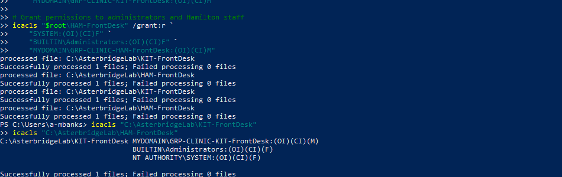

# Project 01: Active Directory & Role-Based Access Control

## Overview

I built an Active Directory lab for Asterbridge Care Technologies, a fictional healthcare technology company with clinics in Kitchener and Hamilton, Ontario. The goal was to provision sample employee identities and test whether Windows enforced clinic-specific folder permissions.

The configuration and tests were performed in Oracle VirtualBox using Windows Server 2022, a domain-joined Windows 10 Pro workstation, Active Directory, PowerShell and NTFS permissions.

## What I configured

- Verified an existing Active Directory domain (`mydomain.com`) and domain-joined workstation.
- Created an Asterbridge OU with six core OUs and eight departmental OUs.
- Created eight security groups and eight enabled sample employee accounts.
- Assigned employees to baseline and role-specific groups.
- Configured NTFS Modify permissions for separate Kitchener and Hamilton front-desk folders.
- Tested domain sign-in and allowed and denied file operations using two receptionist accounts.

## Access design

| Role | Assigned group | Authorized lab folder |
| --- | --- | --- |
| Kitchener receptionist | `GRP-CLINIC-KIT-FrontDesk` | `C:\AsterbridgeLab\KIT-FrontDesk` |
| Hamilton receptionist | `GRP-CLINIC-HAM-FrontDesk` | `C:\AsterbridgeLab\HAM-FrontDesk` |

Both users also belong to `GRP-CORP-AllStaff`. Folder permissions were applied through security groups rather than individual-user ACL entries.

## Test results

| Test | Expected | Observed |
| --- | --- | --- |
| Hannah writes to Kitchener | Allowed | Passed |
| Hannah reads Kitchener file | Allowed | Passed |
| Hannah writes to Hamilton | Denied | Passed |
| Samuel writes to Hamilton | Allowed | Passed |
| Samuel reads Hamilton file | Allowed | Passed |
| Samuel writes to Kitchener | Denied | Passed |

**Result: 6 of 6 core functional tests met their expected outcomes.** Additional checks confirmed Samuel's clinic group membership and denial of Kitchener directory listing.

## Evidence and documentation

- [RBAC test report (PDF)](report/asterbridge-rbac-test-report.pdf)
- [Command reference and test procedure](docs/lab-commands.md)
- [Enabled sample accounts](evidence/E01-enabled-users.png)
- [Hannah's domain identity and groups](evidence/E02-hannah-groups.png)
- [Hannah's allowed and denied PowerShell tests](evidence/E04-hannah-tests.png)
- [Hannah's denied Hamilton folder access](evidence/E05-hannah-hamilton-denied.png)
- [Samuel's allowed and denied PowerShell tests](evidence/E06-samuel-tests.png)
- [Samuel's group and directory-listing checks](evidence/E07-samuel-groups-denial.png)
- [Kitchener test file in File Explorer](evidence/E08-kitchener-file.png)

## What I learned

The lab showed how AD group membership and NTFS ACLs work together to enforce permissions. I also resolved an account provisioning issue caused by the domain's password requirements. That exposed a weakness in the original provisioning script: it printed a success message even when account creation returned an error. Proper error handling is a focus of my next project.

## Scope and limitations

This was a lab using fictional employees and synthetic text files. The tests were limited to local folders on one workstation and two standard user accounts. They do not demonstrate authorization in Asterbridge's fictional clinical application, a production file server, or the organization's wider workforce. The framework references in the report are learning mappings, not evidence of certification or a completed compliance audit.
