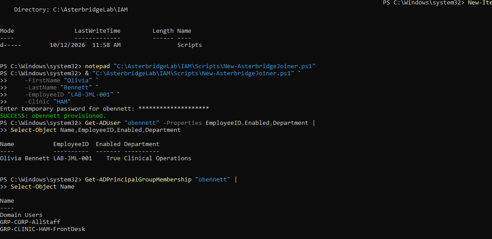
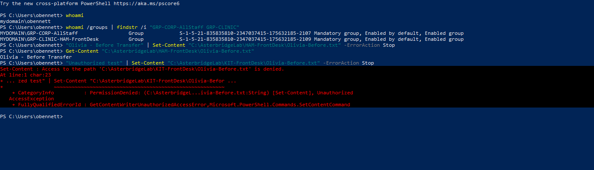
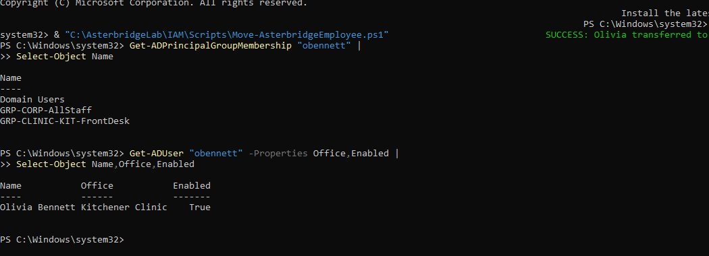
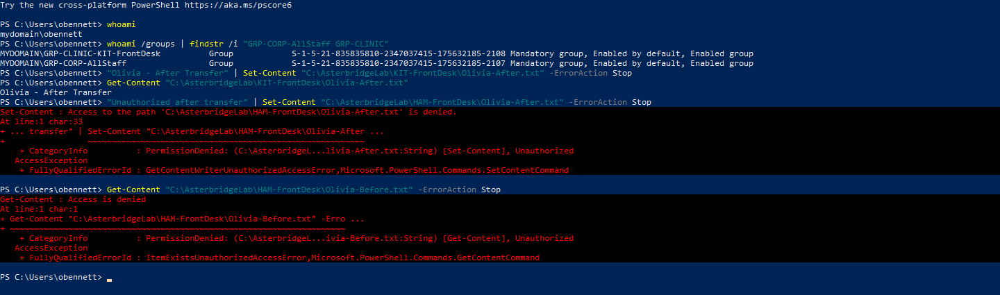
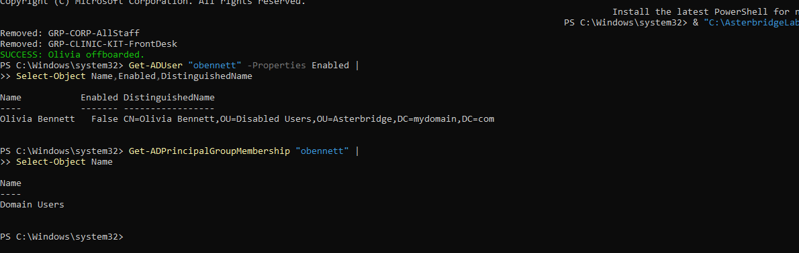
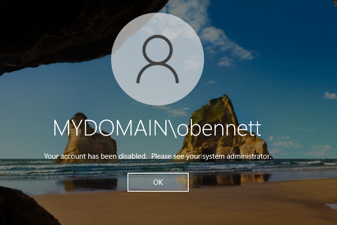

# Project 02: PowerShell User Lifecycle Management

## Overview

I automated a joiner, mover and leaver scenario for Asterbridge Care Technologies, a fictional healthcare technology company. The lab used PowerShell and Active Directory to onboard a test receptionist, transfer her between two clinics, and disable her account when she left.

The scripts were executed in an isolated environment using Windows Server 2022, Active Directory Domain Services and a domain-joined Windows 10 Pro workstation. Olivia Bennett (`LAB-JML-001`) is a synthetic test identity.

## What I implemented

- **Joiner:** Created a disabled account, set a temporary password, assigned corporate and Hamilton access groups, then enabled the account.
- **Mover:** Removed Hamilton group membership, added Kitchener group membership and updated the Office attribute. Retested access after a new sign-in.
- **Leaver:** Disabled the account, removed tested access groups and moved the account to the Disabled Users OU.
- **Verification:** Checked AD attributes, group memberships, allowed and denied file operations and a fresh Windows sign-in after offboarding.

## Test results

| Stage | Verified outcome | Result |
| --- | --- | --- |
| Joiner | Account enabled with corporate and Hamilton groups | Passed |
| Before transfer | Hamilton write/read allowed; Kitchener write denied | Passed |
| Mover | Hamilton group removed; Kitchener group added; office updated | Passed |
| After transfer | Kitchener write/read allowed; Hamilton write/read denied | Passed |
| Leaver | Account disabled, access groups removed, moved to Disabled Users | Passed |
| Fresh sign-in | Windows rejected sign-in for the disabled account | Passed |

## Onboarding and initial access

<table><tr><td width="50%" valign="top"><strong>Provisioning and group assignment</strong> </td><td width="50%" valign="top"><strong>Hamilton allowed; Kitchener denied</strong> </td></tr></table>

## Clinic transfer

<table><tr><td width="50%" valign="top"><strong>AD groups and office updated</strong> </td><td width="50%" valign="top"><strong>Access tested after transfer</strong> </td></tr></table>

## Offboarding

<table><tr><td width="50%" valign="top"><strong>Account disabled and groups removed</strong> </td><td width="50%" valign="top"><strong>Fresh sign-in rejected</strong> </td></tr></table>

[Domain controller connectivity checks](evidence/JML-E06-domain-connectivity.png)

## Scripts and documentation

- [Joiner script](scripts/New-AsterbridgeJoiner.ps1)
- [Mover script](scripts/Move-AsterbridgeEmployee.ps1)
- [Leaver script](scripts/Remove-AsterbridgeLeaver.ps1)
- [Control test report (PDF)](report/Asterbridge_JML_Control_Test_Report_v1.0.pdf)
- [Test cases and results](docs/test-cases.md)
- [Script review and limitations](docs/script-review.md)

The three PowerShell scripts are the original tested versions. The mover and leaver are restricted to Olivia's lab account; they are not general-purpose or production-ready lifecycle automation.

## What I learned

I tested why account changes must be verified from both Active Directory and a user workstation. A new Windows sign-in was necessary to obtain Olivia's updated security group token after her clinic transfer.

During offboarding, an earlier Windows session was observed after account disabling, but a later fresh sign-in was rejected. The available evidence does not establish whether the earlier behavior came from a retained session or cached credentials.

The scripts also revealed areas for improvement: detailed audit logs, recovery after partial changes, approval records, comprehensive entitlement reviews and cloud session revocation.

## Scope and limitations

This real lab exercise covered one synthetic identity, an AD domain, one workstation and two local NTFS folders. It does not demonstrate production HR integration, live healthcare applications, cloud account deactivation, removal of all entitlements or an independent compliance audit.
