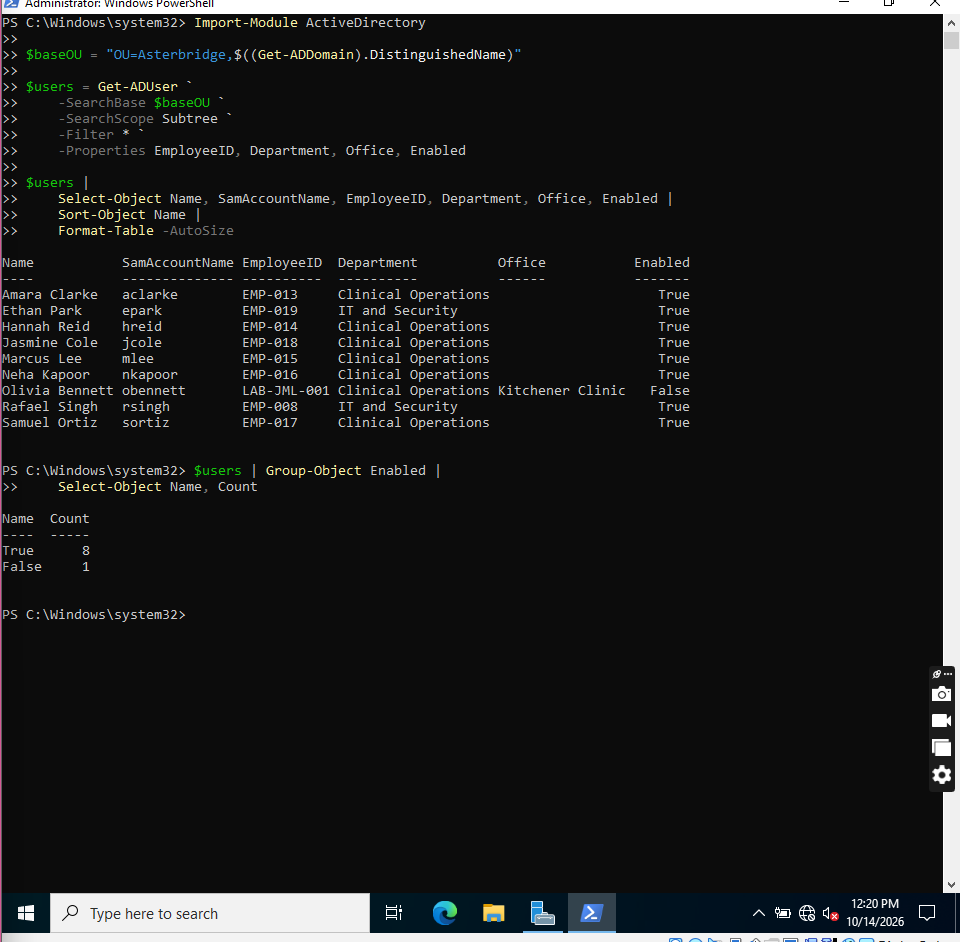
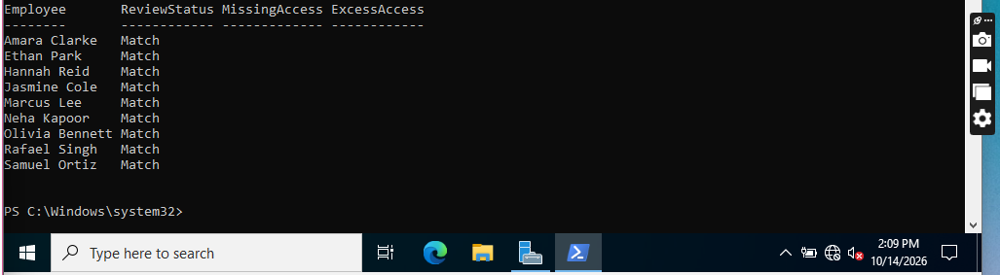
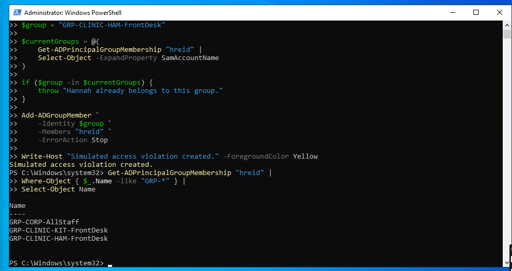
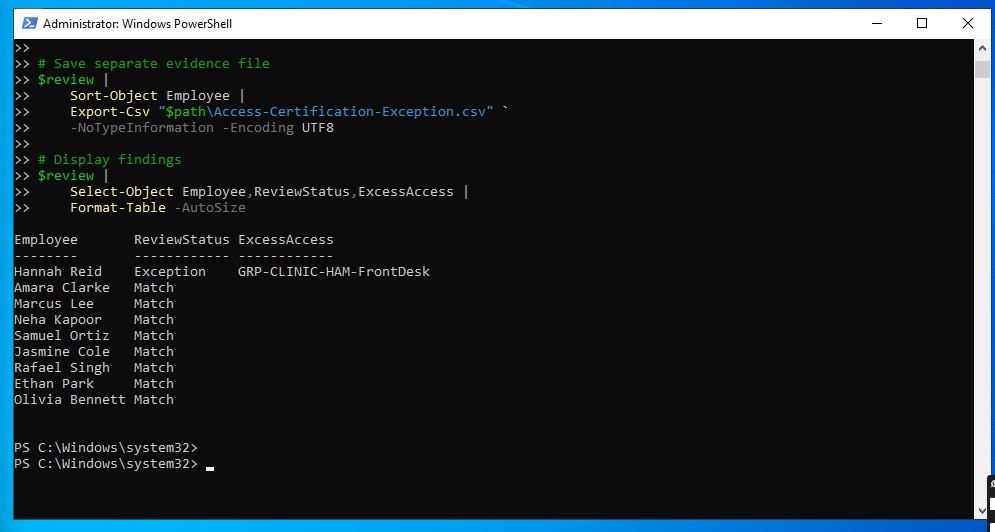
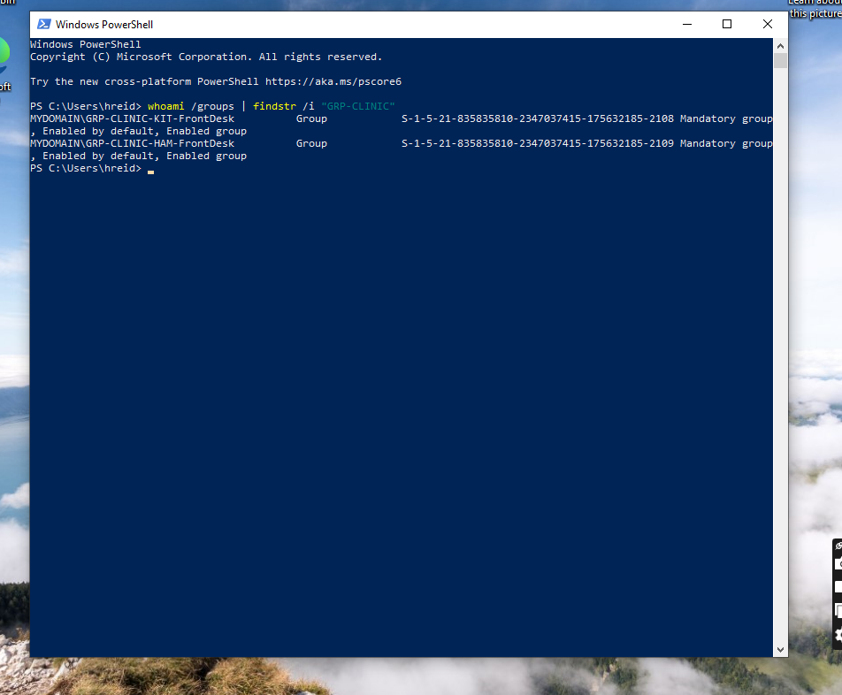
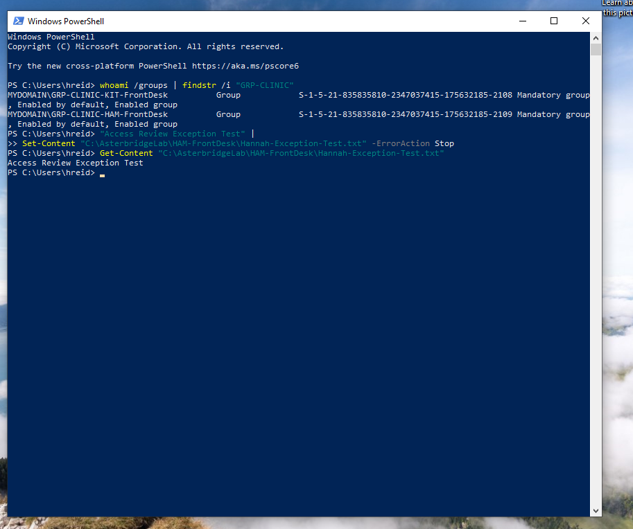
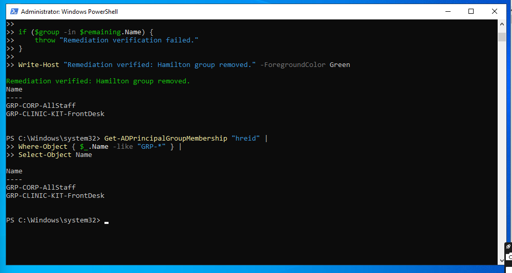
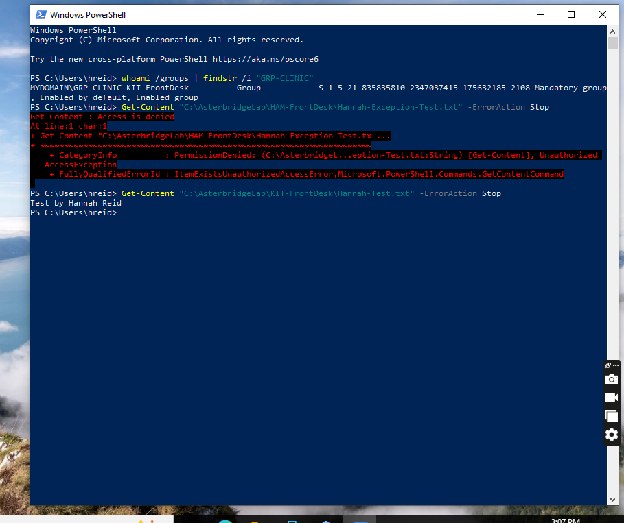
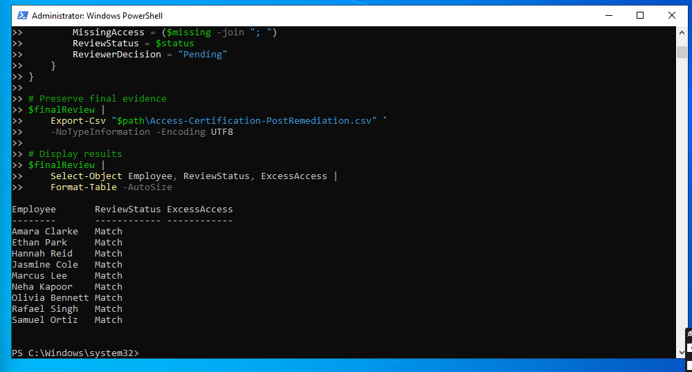

# Project 03: Active Directory Access Reviews & IAM Audit

## Overview

I reviewed user access for Asterbridge Care Technologies, a fictional healthcare technology company. Using Active Directory and PowerShell, I compared nine accounts against a role-access list. I then added an incorrect group membership to see whether the review would detect it and whether it affected file access.

I ran the lab in VirtualBox with Windows Server 2022 and a domain-joined Windows 10 workstation.

## What I did

- Collected nine user accounts and their assigned `GRP-*` security groups.
- Compared their memberships with the access expected for their roles.
- Reviewed privileged group memberships separately.
- Added Hannah Reid, a Kitchener receptionist, to the Hamilton Front Desk group as a test.
- Detected the extra access, then confirmed she could create and read a file in the Hamilton folder.
- Removed the extra membership and tested the folder permissions again after a fresh sign-in.
- Saved the baseline, exception and final access review results as CSV files.

## Results

| Review | Accounts matching | Exceptions |
| --- | ---: | ---: |
| Before the test | 9 / 9 | 0 |
| After adding the extra group | 8 / 9 | 1 |
| After removing the extra group | 9 / 9 | 0 |

The exception was Hannah's additional `GRP-CLINIC-HAM-FrontDesk` membership. These results show a technical comparison against the lab's role-access list. The reviewer decisions are still marked `Pending`; no manager sign-off was performed.

## Access review evidence

<table>
<tr><td width="50%" valign="top">Identity population </td><td width="50%" valign="top">Clean role baseline </td></tr>
<tr><td width="50%" valign="top">Controlled Hamilton group assignment </td><td width="50%" valign="top">Access review exception detected </td></tr>
</table>

## Access testing and remediation

<table>
<tr><td width="50%" valign="top">Updated Windows group token </td><td width="50%" valign="top">Hamilton file access succeeded </td></tr>
<tr><td width="50%" valign="top">Unauthorized membership removed </td><td width="50%" valign="top">Hamilton access denied after fresh sign-in </td></tr>
</table>

Final check: all nine accounts matched the role-access list again.

## Files

- [Access review report (PDF)](report/Asterbridge_Project03_IAM_Access_Review_Report_v1.0.pdf)
- [Review notes](docs/README-review-notes.md)
- [PowerShell reference script](scripts/Export-ADAccessCertification.ps1)
- [AD account inventory](data/AD-Access-Inventory.csv)
- [Baseline access review](data/Access-Certification-Baseline.csv)
- [Access review with the exception](data/Access-Certification-Exception.csv)
- [Post-remediation access review](data/Access-Certification-PostRemediation.csv)
- [Role-access list used for this lab](data/Simulated-Role-Baseline.csv)

The PowerShell reference script was put together from the commands I ran during the exercise. I haven't tested that file as a standalone script.

## What I learned

I learned why checking group memberships alone isn't enough. Hannah's extra membership gave her access to the Hamilton folder, which I confirmed by creating and reading a test file. After removing the membership, I signed her out and back in so Windows would pick up the change. Hamilton access was then denied, while Kitchener access still worked.

## Scope and limits

This was a lab using fictional employees and test files. I reviewed nine accounts in the Asterbridge OU and groups beginning with `GRP-`. I tested folder access on one Windows 10 workstation, not clinical applications or cloud services. The privileged-account inventory is kept in my internal workbook. This exercise did not include a formal manager access review.
