# Project 04: Hybrid Active Directory & Okta IAM

## Overview

I connected my Asterbridge Active Directory lab in Oracle VirtualBox to Okta using a Windows Server 2022 VM in Azure. I wanted to test how AD users, security groups and account changes carry over to Okta.

I joined the Azure server to `mydomain.com` over a Tailscale connection, configured split DNS and installed Okta AD Agent 3.23.0. All users and company details in this lab are fictional.

## What I configured

- Joined an Azure member server to the existing AD domain hosted in VirtualBox.
- Installed the Okta AD Agent using a dedicated `OktaService` account.
- Limited the directory import to the Asterbridge employee OUs and security groups.
- Imported eight employee accounts and eight AD security groups into Okta.
- Assigned a test Bookmark App, Asterbridge Front Desk Portal, to `GRP-CLINIC-HAM-FrontDesk`.
- Used manual full imports to check group changes and account deactivation and reactivation.

## Test results

| Test | Observed result |
| --- | --- |
| AD import | 8 users and 8 groups imported |
| Group membership | `GRP-CORP-AllStaff` contained all 8 employees |
| Delegated authentication | Hannah Reid authenticated using her AD credentials |
| Group-based assignment | Samuel Ortiz received the Front Desk Portal assignment through his AD group |
| Access removal | Removing Samuel from the AD group removed the Okta application assignment after import |
| Access restoration | Re-adding Samuel to the group restored the application assignment |
| Deprovisioning | Disabling Samuel in AD deactivated his Okta account after import |
| Reactivation | Re-enabling Samuel in AD restored his Okta account and group-based assignment after reactivation settings were corrected |

The import performed after account disabling reported one user removed from the imported set. Samuel's existing Okta profile remained present with the status `Deactivated`.

## Evidence

The screenshots below show the integration and the access changes I tested. The complete set is listed in the [evidence index](evidence/README.md), with test references in [test cases and results](docs/test-cases.md).

### Directory integration and authentication

<table>
<tr><td width="50%" valign="top">AD integration completed <a href="evidence/E01-ad-integration-complete.png">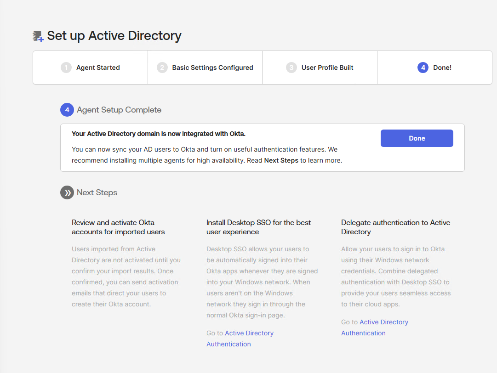</a></td><td width="50%" valign="top">Initial import: 8 users and 8 groups <a href="evidence/E02-first-import-results.png">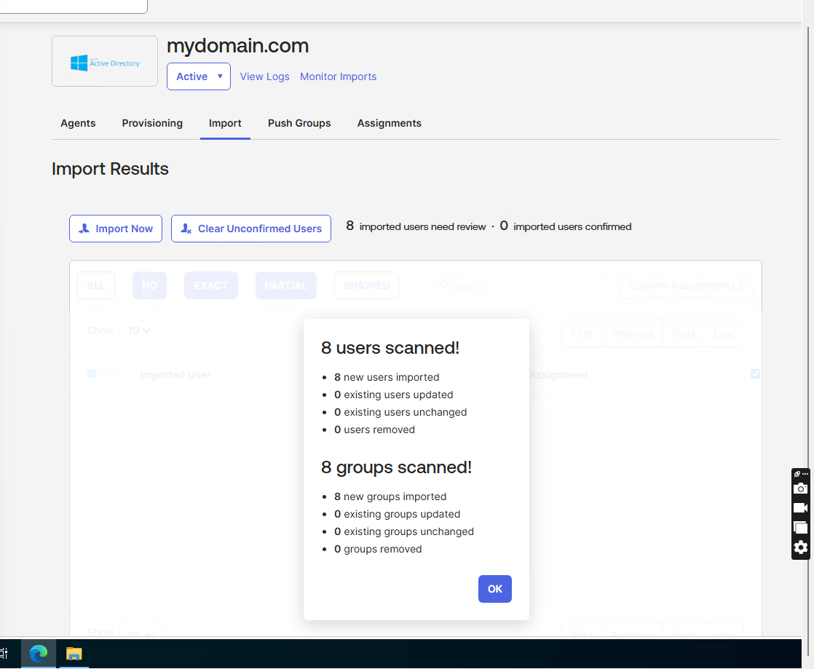</a></td></tr>
<tr><td width="50%" valign="top">Imported security groups <a href="evidence/E03-ad-groups-in-okta.png">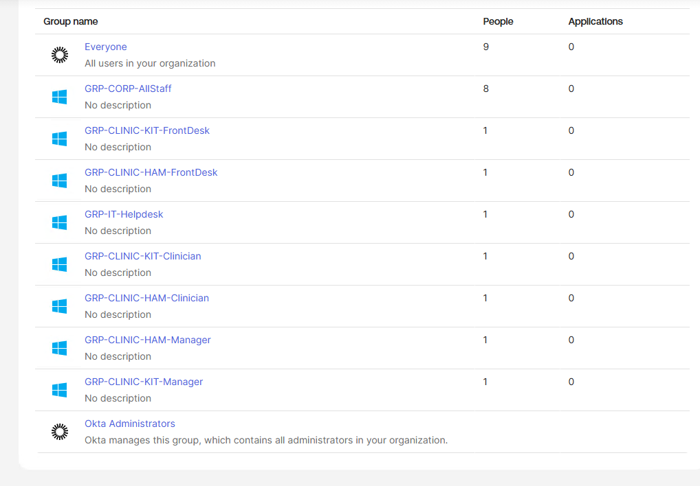</a></td><td width="50%" valign="top">Hannah's delegated authentication passed <a href="evidence/E05-delegated-auth-success.png">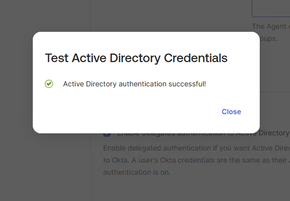</a></td></tr>
</table>

### Group-based application access

<table>
<tr><td width="50%" valign="top">Samuel assigned through the AD group <a href="evidence/E06-group-based-app-assignment.png">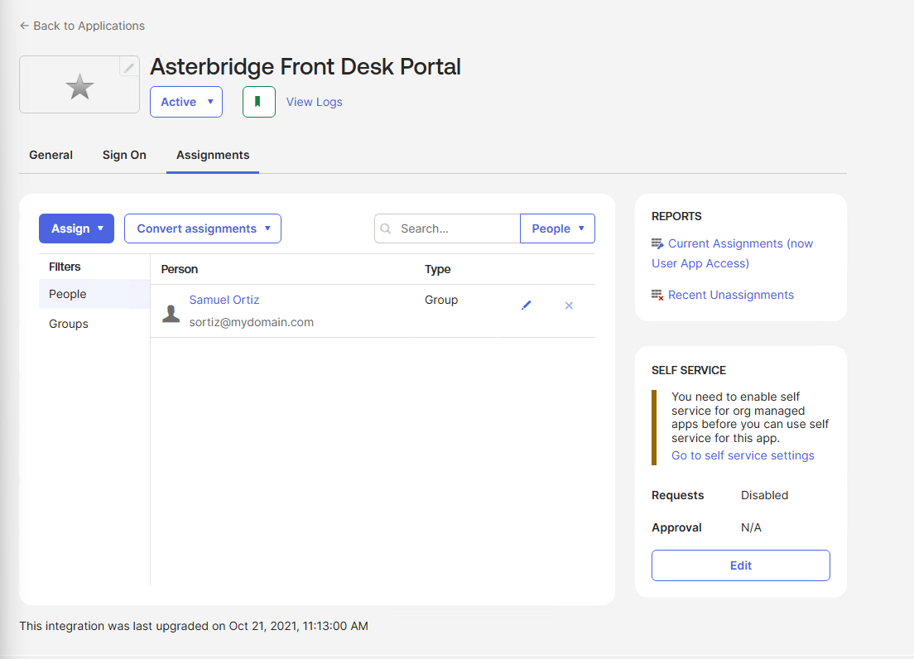</a></td><td width="50%" valign="top">AD group membership removed in Okta <a href="evidence/E08-removed-okta-group-membership.png">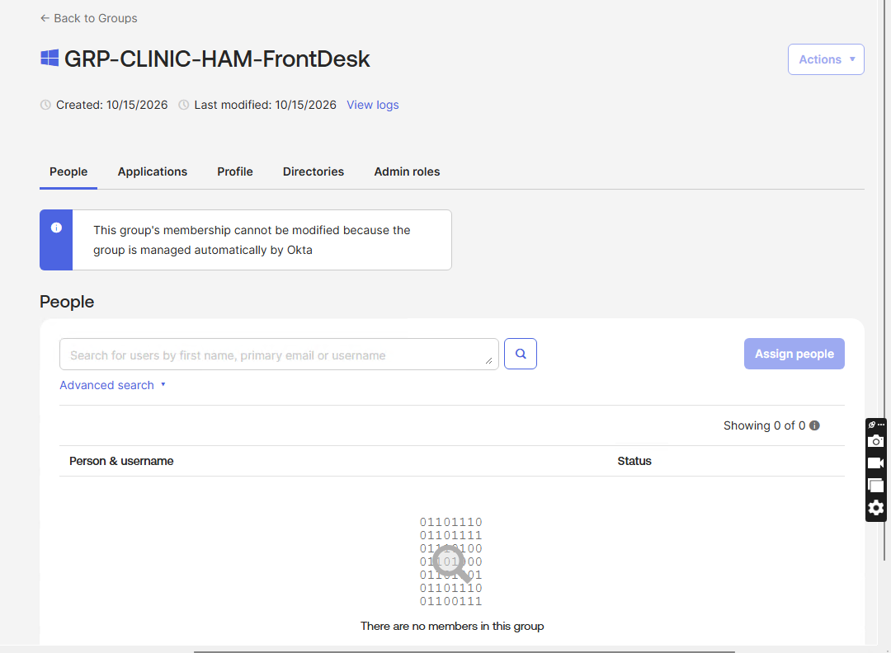</a></td></tr>
<tr><td width="50%" valign="top">Application assignment revoked <a href="evidence/E09-app-assignment-revoked.png">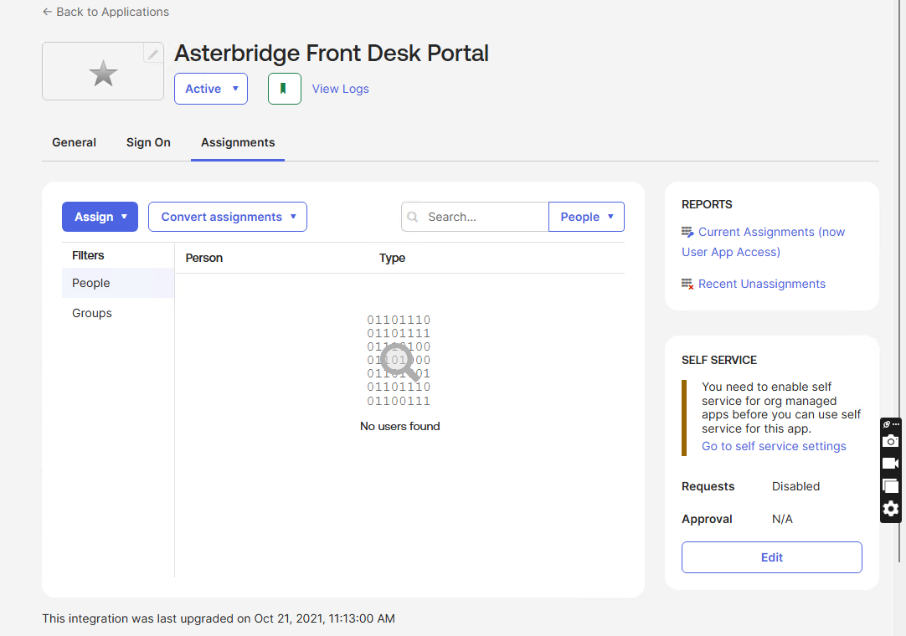</a></td><td width="50%" valign="top">Application assignment restored <a href="evidence/E10-app-assignment-restored.png">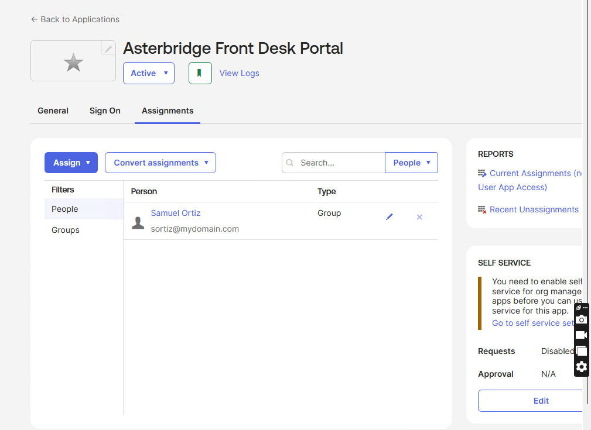</a></td></tr>
</table>

### Account deactivation and restoration

<table>
<tr><td width="50%" valign="top">Import after disabling Samuel <a href="evidence/E11-deactivation-import-results.png">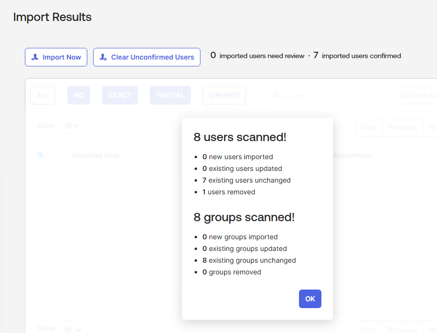</a></td><td width="50%" valign="top">Samuel deactivated in Okta <a href="evidence/E12-okta-account-deactivated.png">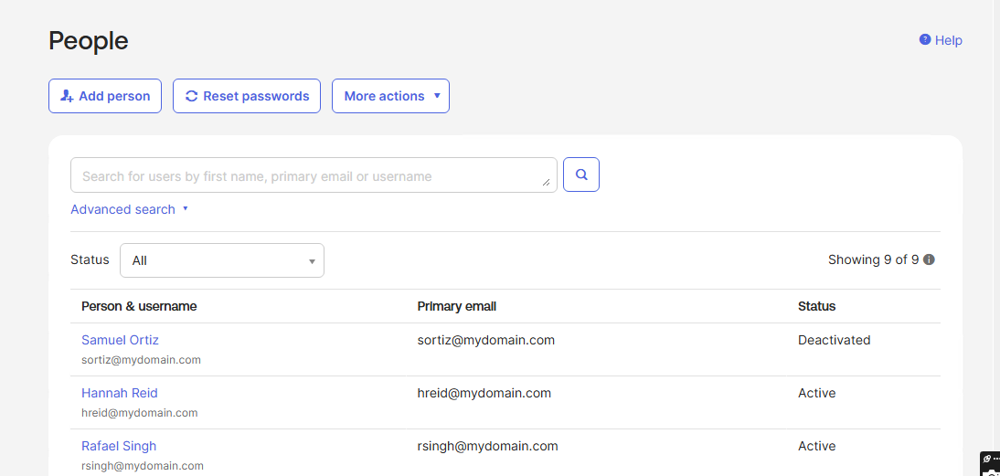</a></td></tr>
<tr><td width="50%" valign="top">Samuel's account reactivated <a href="evidence/E13-okta-account-reactivated.png">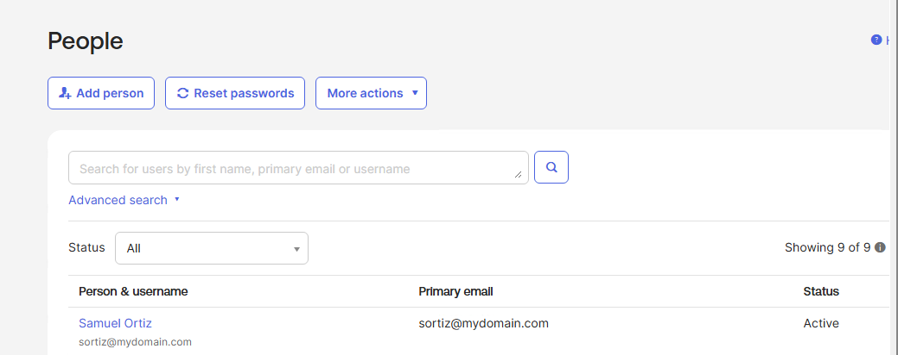</a></td><td width="50%" valign="top">Group-based app assignment restored <a href="evidence/E14-app-assignment-restored-after-reactivation.png">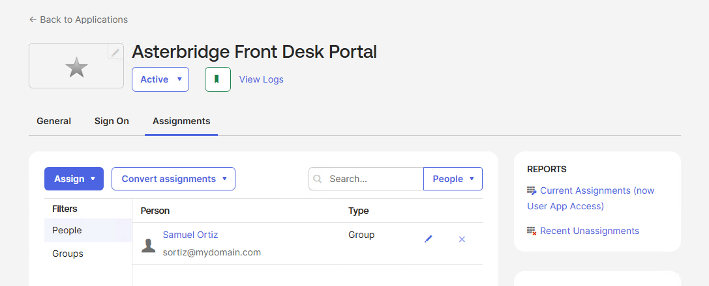</a></td></tr>
</table>

## What I learned

I saw how AD group membership can control application assignments in Okta. When I removed Samuel from the Hamilton Front Desk group, his application assignment disappeared after a full import. It returned after I restored the group membership.

Reactivation needed an extra configuration change. Samuel's first reassignment failed because Okta still considered his account inactive. After I enabled `Reactivate deactivated Okta users` and repeated the import, his account and assignment returned.

## Scope and limitations

This was a lab with eight fictional employees, one Azure-hosted AD Agent and an Okta trial. I ran manual imports rather than measuring automatic sync intervals. The Bookmark App tested Okta assignments; it did not enforce access to a live clinical system. I did not test end-user SSO, MFA, active-session termination or production application provisioning.

The servers communicated over Tailscale, but I did not configure LDAPS or a highly available agent setup. The installer also reported a service-account permissions warning that was not separately validated or remediated. The results demonstrate the actions tested here, not a production-ready identity deployment or a compliance audit.
