# Project 05: Non-Human Identity & Service Account Governance

## Overview

I reviewed service accounts in the Asterbridge Active Directory lab, including `OktaService`, which supports my existing Okta integration. I then created two test identities to examine service-account permissions and investigate an account left active after its application was retired.

The main exercise was to identify the account, check for obvious dependencies, remove unnecessary access and confirm the change in Active Directory.

## What I did

- Checked the Service Accounts OU, the existing `OktaService` account and managed service accounts in AD.
- Created `svc-clinic-backup` and `svc-legacy-reports` as test identities.
- Assigned backup Read and Write security groups and configured NTFS permissions on a workstation's test folders.
- Flagged `svc-legacy-reports` because it was enabled, marked as belonging to a retired application and had no assigned owner.
- Checked the domain controller and workstation for Windows services and scheduled tasks configured to use the account. No matches were found on either machine.
- Disabled `svc-legacy-reports`, removed it from both backup groups and verified that only `Domain Users` remained.
- Saved the original inventory and post-remediation results as CSV files.

## Results

| Account | Initial review | Outcome |
| --- | --- | --- |
| `OktaService` | Enabled; member of Domain Users; description empty; password set not to expire | Review observations recorded; account unchanged |
| `svc-clinic-backup` | Disabled with backup Read and Write memberships | NTFS permissions configured; effective scheduled-task test not verified |
| `svc-legacy-reports` | Enabled with backup Read and Write memberships; retired application and no assigned owner | Disabled; backup group memberships removed |

The `svc-legacy-reports` finding was deliberately created for this lab. The retirement decision was simulated, not approved through a real change process.

## Service account discovery and setup

<table>
<tr><td width="50%" valign="top">Service Accounts OU and OktaService discovery <a href="evidence/E01-service-account-discovery.png">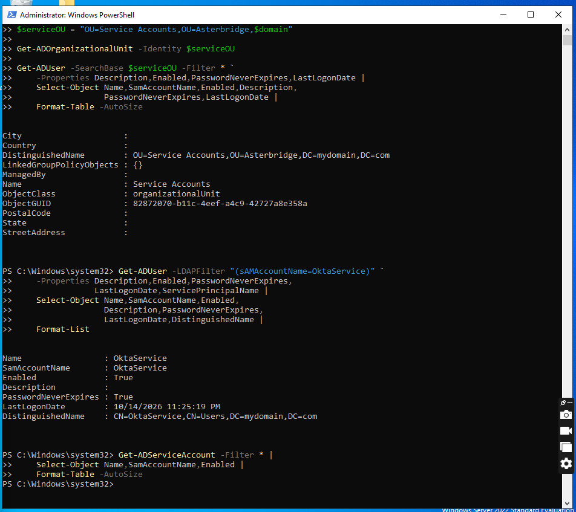</a></td><td width="50%" valign="top">OktaService account settings and groups <a href="evidence/E02-okta-account-review.png">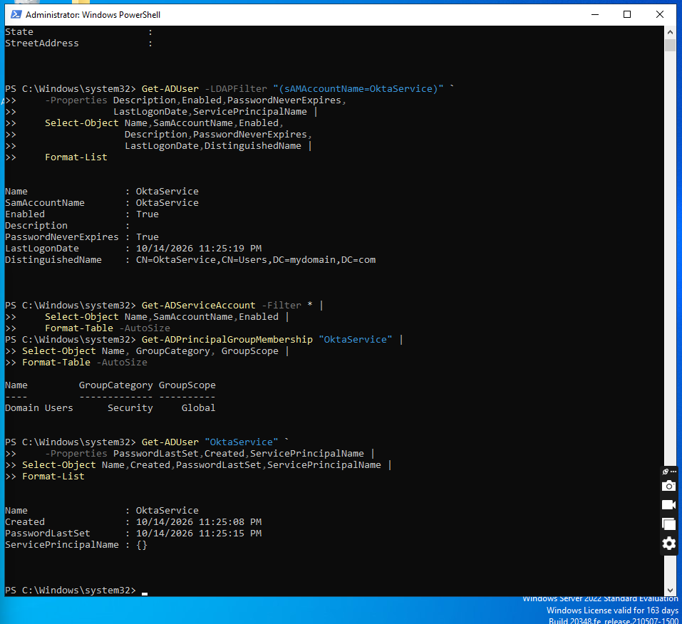</a></td></tr>
<tr><td width="50%" valign="top">Two test accounts created disabled <a href="evidence/E03-test-accounts-created.png">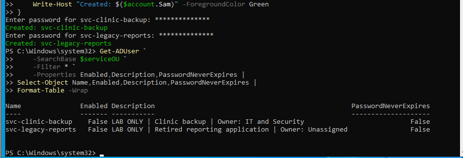</a></td><td width="50%" valign="top">Backup identity group assignments <a href="evidence/E04-backup-group-memberships.png">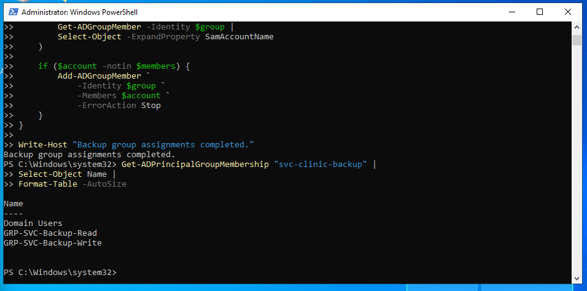</a></td></tr>
<tr><td width="50%" valign="top">Backup test folder permissions <a href="evidence/E05-backup-ntfs-acls.png">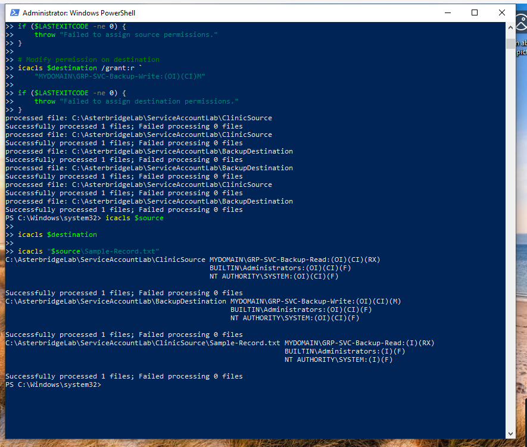</a></td><td width="50%" valign="top">Backup account disabled after setup <a href="evidence/E06-backup-account-disabled.png">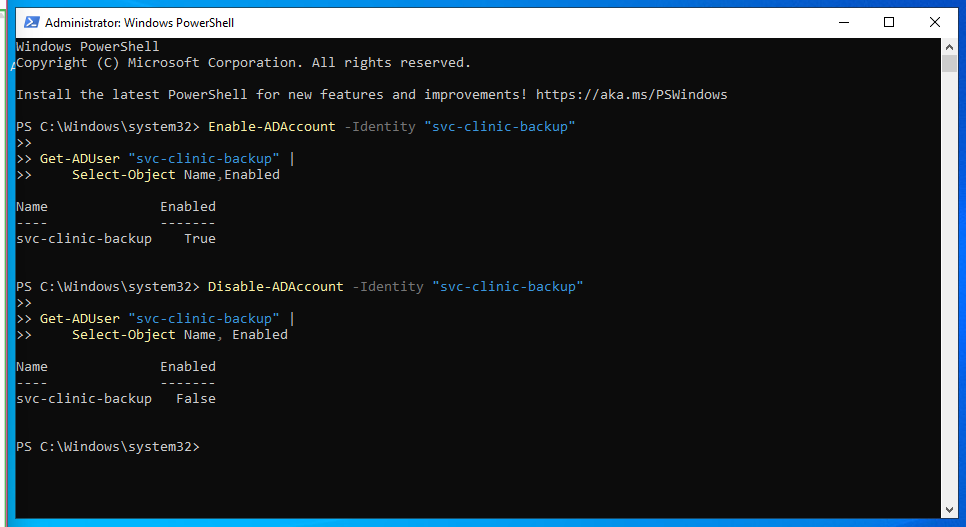</a></td></tr>
</table>

The backup permission test through Task Scheduler was started but not completed. I have not treated it as a passed control test.

## Orphaned account investigation and remediation

<table>
<tr><td width="50%" valign="top">Controlled orphaned-account scenario <a href="evidence/E07-orphan-account-introduced.png">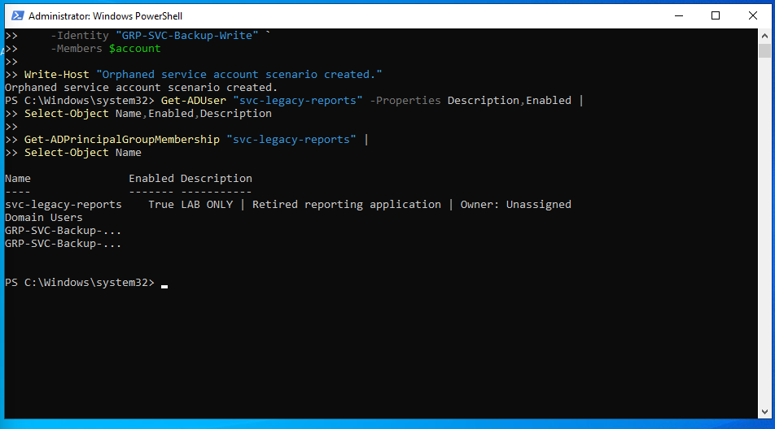</a></td><td width="50%" valign="top">Inventory detects the account <a href="evidence/E08-inventory-orphan-flag.png">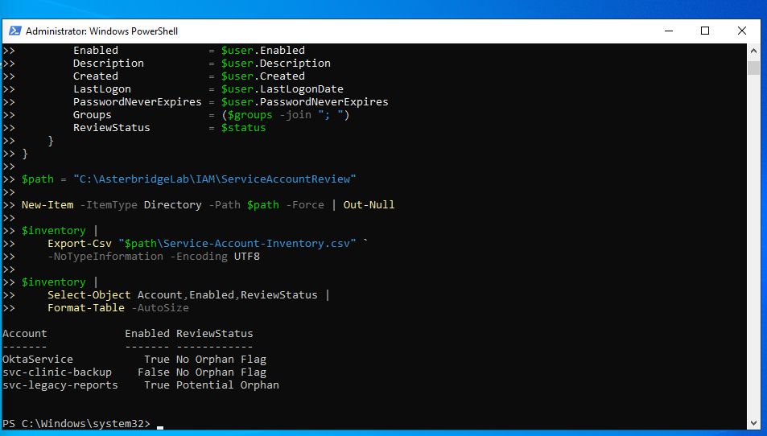</a></td></tr>
<tr><td width="50%" valign="top">Domain controller dependency check <a href="evidence/E09-dependency-check-dc.png">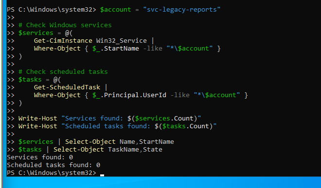</a></td><td width="50%" valign="top">Workstation dependency check <a href="evidence/E10-dependency-check-ws.png">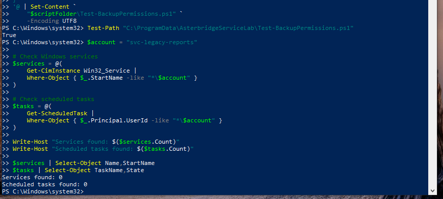</a></td></tr>
</table>

Final verification: `svc-legacy-reports` was disabled, both backup group memberships were removed, and the post-remediation inventory showed only `Domain Users`.

<a href="evidence/E11-orphan-remediation-verified.png">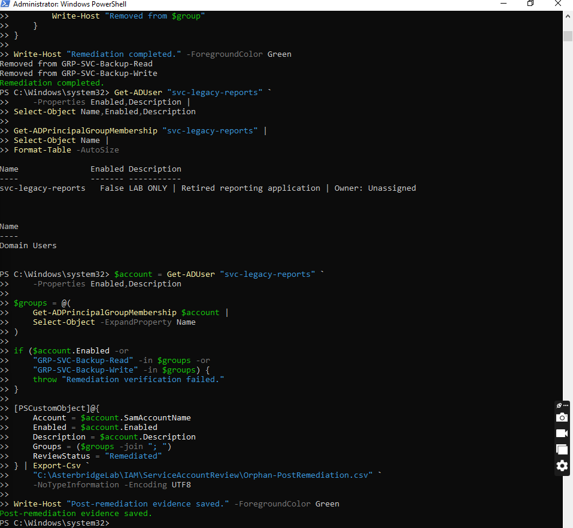</a>

## Files

- [Service account review report (PDF)](report/Asterbridge_Project05_Service_Account_Review.pdf)
- [Service account review workbook (Excel)](report/Asterbridge_Project05_Service_Account_Review.xlsx)
- [Initial service account inventory (CSV)](data/Service-Account-Inventory.csv)
- [Post-remediation account snapshot (CSV)](data/Orphan-PostRemediation.csv)
- [Finding and remediation notes](docs/findings-and-remediation.md)
- [Test steps and evidence index](docs/test-notes.md)
- [PowerShell inventory reference](scripts/Get-AsterbridgeServiceAccounts.ps1)

The reference script was reconstructed from the interactive commands. I have not separately tested it as a standalone file.

## What I learned

Service-account ownership matters as much as the permissions attached to an account. In this lab, an account for a retired application was still enabled and belonged to two backup groups. I checked the machines in scope for obvious dependencies before disabling it, then confirmed that the extra groups were removed.

I also saw why a successful configuration command isn't the same as a completed test. The backup folder permissions were configured, but I couldn't confirm the scheduled-task test results.

## Scope and limits

This was a lab with fictional company data and two deliberately created test accounts. I examined three named AD identities and checked services and scheduled tasks on two Windows machines. I didn't review every service identity, dependency, local right or application configuration in the environment. No live clinical data was involved. The `OktaService` account was left unchanged because it supports the working hybrid IAM connection.