# Project 06: IT Service Management & IAM Support Simulation

## Overview

I used Jira Service Management, Active Directory and Okta to investigate four IT support requests for Asterbridge Care Technologies. I also created 10 additional Jira tickets to practice queue management and decide what needed attention first.

The employees and support requests are fictional. I carried out the technical steps in my Asterbridge lab.

## Environment

- Jira Service Management, Asterbridge IT Service Desk
- Active Directory on Windows Server 2022 in Oracle VirtualBox
- Okta AD Agent on an Azure Windows Server connected through Tailscale
- Okta, Okta Verify for Windows 11 and Windows Hello

I built the AD–Okta connection in [Project 04](../04-okta-hybrid-iam/).

## Evidence gallery

### AIT-1: Application access

I checked Samuel Ortiz's account, group membership and Front Desk Portal assignment. Everything was in place, so I removed his Front Desk group in AD to reproduce a missing assignment, synchronized the change to Okta, and then restored it. The application assignment disappeared and returned as expected.

<table>
<tr><td width="50%" valign="top"><a href="evidence/AIT-1-01-jira-request.webp">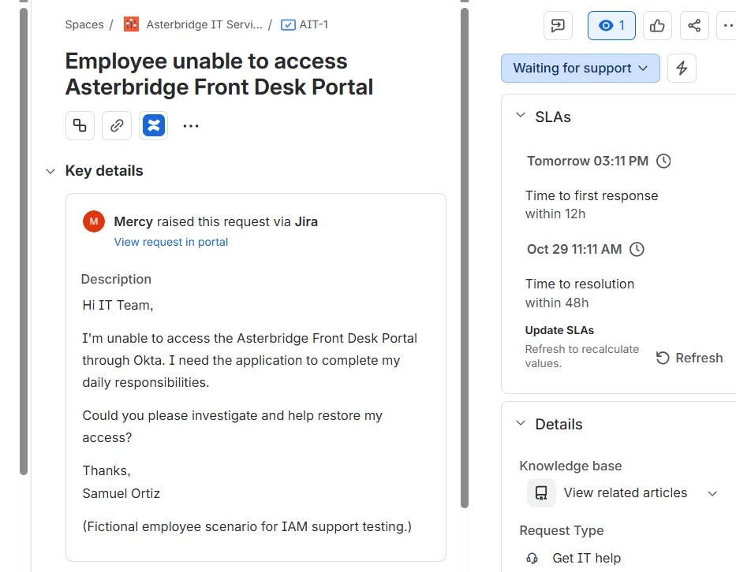</a> Logged the reported access issue in Jira.</td><td width="50%" valign="top"><a href="evidence/AIT-1-02-ad-group-removed.webp">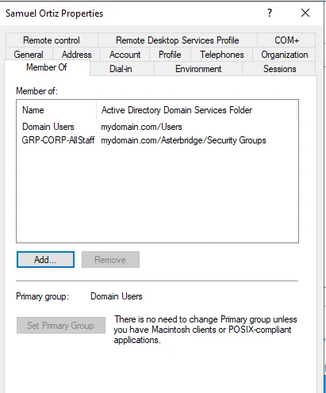</a> Removed Samuel from the Front Desk group in AD.</td></tr>
<tr><td width="50%" valign="top"><a href="evidence/AIT-1-03-okta-assignment-removed.webp">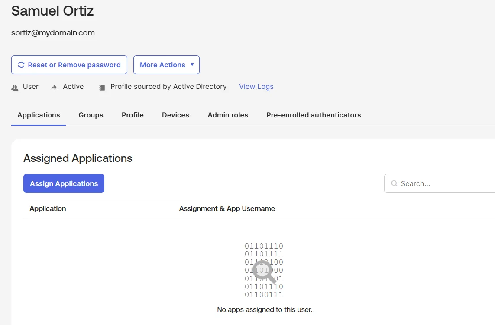</a> Okta showed no application assignment after import.</td><td width="50%" valign="top"><a href="evidence/AIT-1-04-okta-assignment-restored.webp">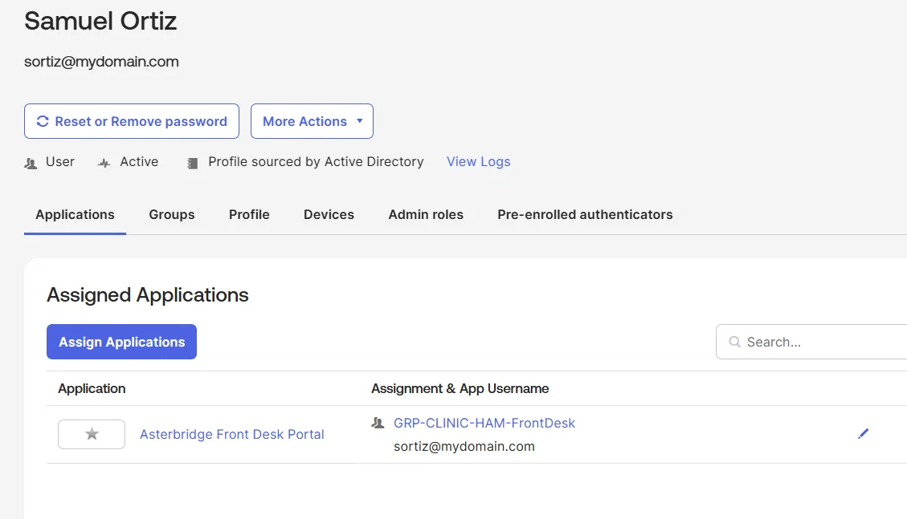</a> The assignment returned after I restored his group membership.</td></tr>
</table>

### AIT-2: Employee onboarding

I created Jordan Ellis's AD account and added the AllStaff and Hamilton Front Desk groups. After the Okta import, Jordan's account was active with both groups and the Front Desk Portal assigned.

<table>
<tr><td width="50%" valign="top"><a href="evidence/AIT-2-01-jira-onboarding.webp">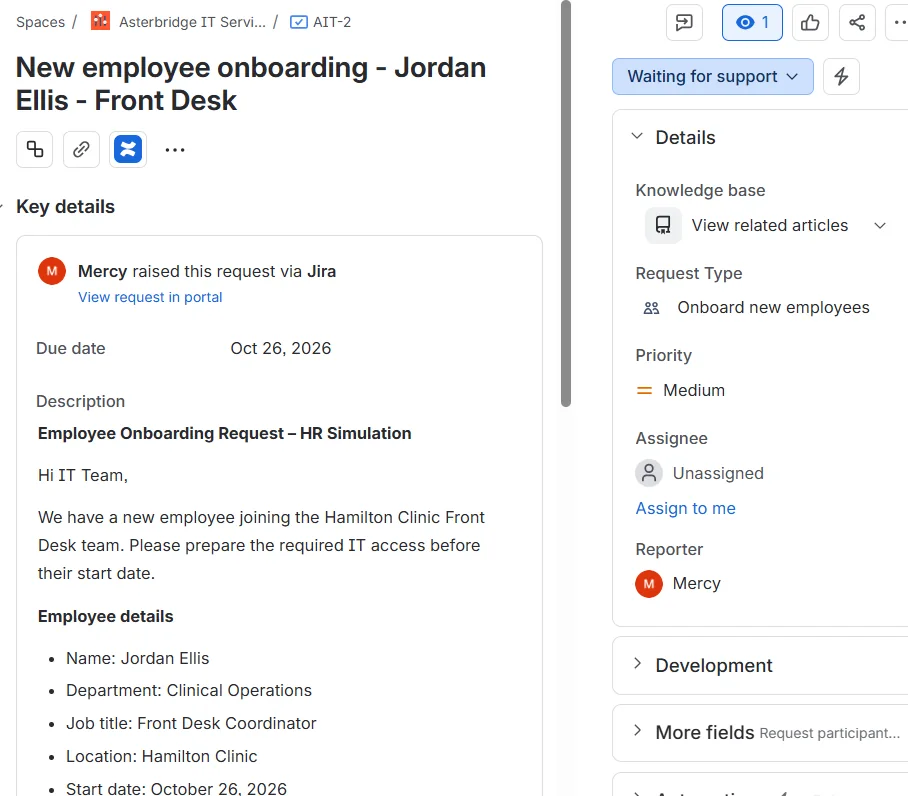</a> Created the onboarding request in Jira.</td><td width="50%" valign="top"><a href="evidence/AIT-2-02-ad-role-groups.webp">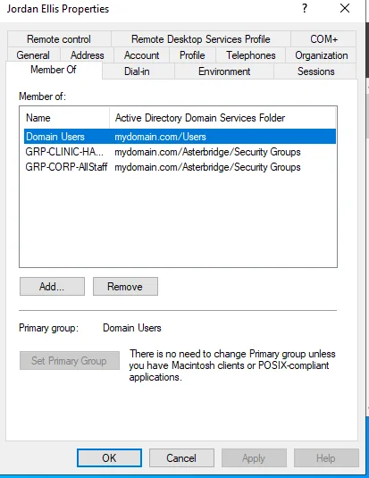</a> Added Jordan to the two AD security groups.</td></tr>
<tr><td width="50%" valign="top"><a href="evidence/AIT-2-03-okta-groups.webp">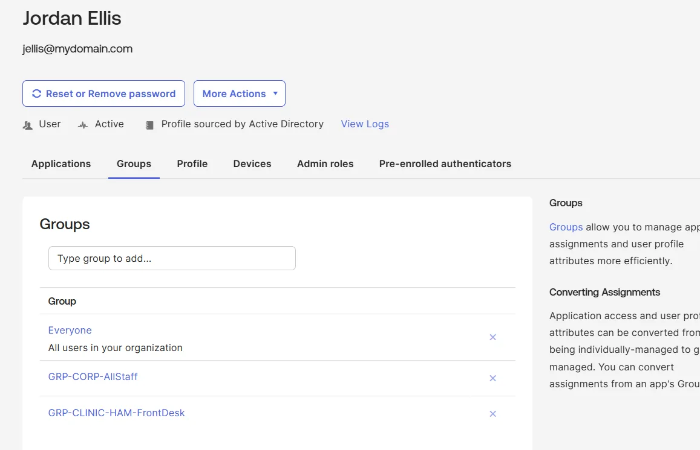</a> Confirmed both groups in Jordan's Okta profile.</td><td width="50%" valign="top"><a href="evidence/AIT-2-04-okta-app-assignment.webp">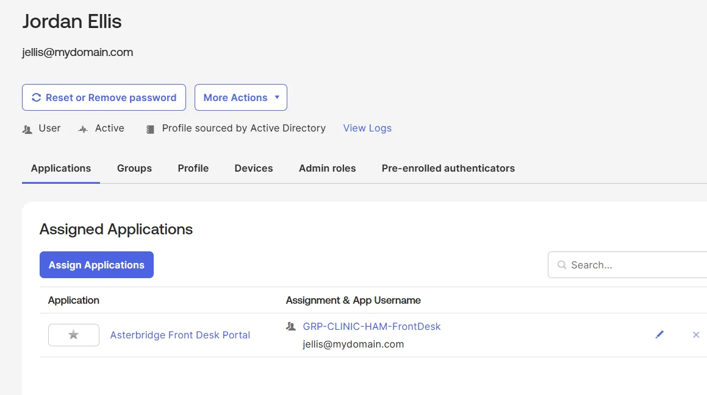</a> Confirmed the Front Desk Portal assignment came from the group.</td></tr>
</table>

### AIT-3: MFA setup and recovery

Hannah Reid had no enrolled authenticator. I installed Okta Verify on Windows 11, enrolled her account and confirmed a successful MFA sign-in in Okta's System Log. I then reset Okta Verify and re-enrolled it. The new enrollment and factor activation appeared in Okta.

<table>
<tr><td width="50%" valign="top"><a href="evidence/AIT-3-01-no-enrolled-authenticators.webp">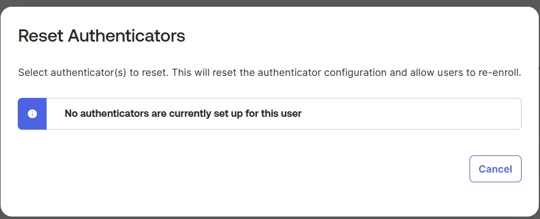</a> Found no enrolled authenticators for Hannah.</td><td width="50%" valign="top"><a href="evidence/AIT-3-02-mfa-success-log.webp">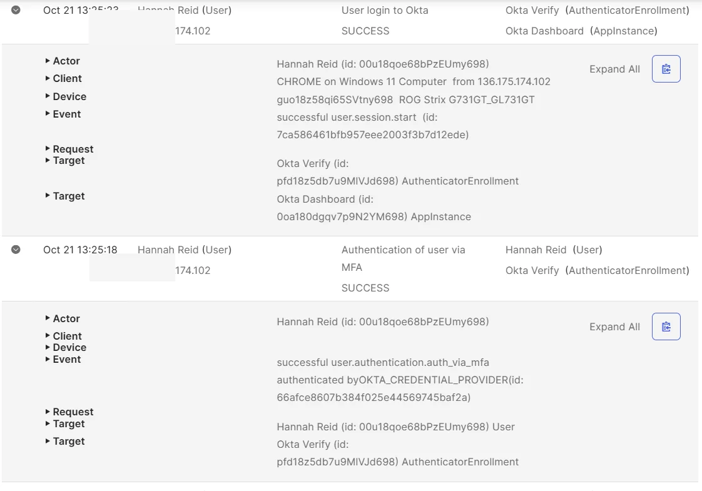</a> Confirmed a successful MFA sign-in before the reset.</td></tr>
<tr><td width="50%" valign="top"><a href="evidence/AIT-3-03-reset-confirmation.webp">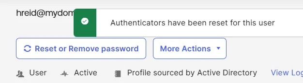</a> Reset Hannah's Okta Verify authenticator.</td><td width="50%" valign="top"><a href="evidence/AIT-3-04-reenrollment-prompt.webp">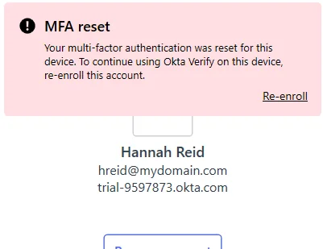</a> Okta Verify prompted for re-enrollment on Windows.</td></tr>
<tr><td width="50%" valign="top"><a href="evidence/AIT-3-05-reenrolled-authenticator.webp">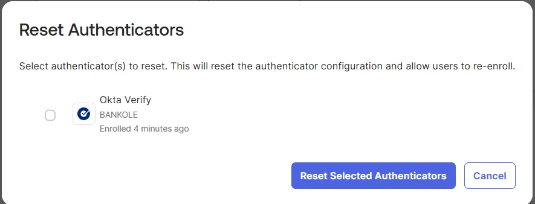</a> Confirmed the new enrollment in the Admin Console.</td><td width="50%" valign="top"><a href="evidence/AIT-3-06-reenrollment-log.webp">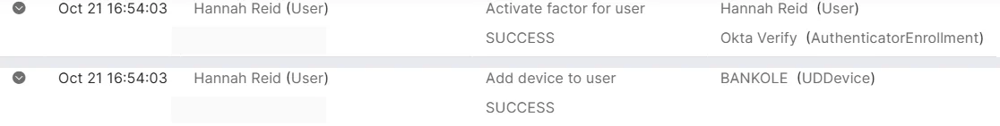</a> System Log confirmed factor activation and device registration.</td></tr>
</table>

### AIT-4: Privileged access request

Samuel requested Okta Super Administrator access to troubleshoot one application. I reviewed the request, documented the missing approvals and declined the access in the simulated review. I also checked his individually assigned administrator roles in Okta.

<table>
<tr><td width="50%" valign="top"><a href="evidence/AIT-4-01-jira-privileged-request.webp">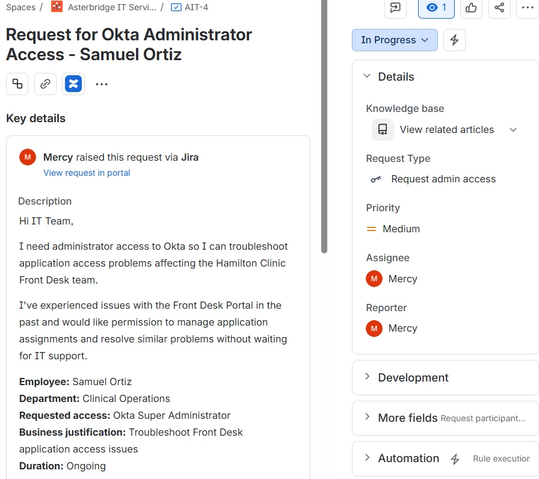</a> Logged the Super Administrator request in Jira.</td><td width="50%" valign="top"><a href="evidence/AIT-4-02-no-individual-admin-roles.webp">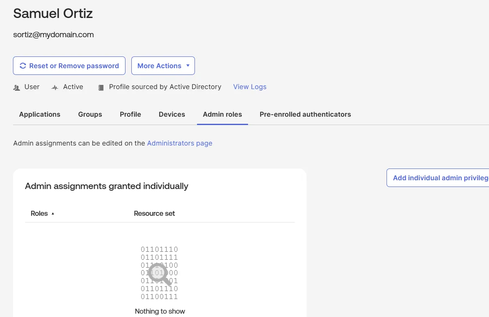</a> Checked Samuel's individually assigned admin roles.</td></tr>
<tr><td width="50%" valign="top"><a href="evidence/AIT-4-03-jira-cancellation-form.webp">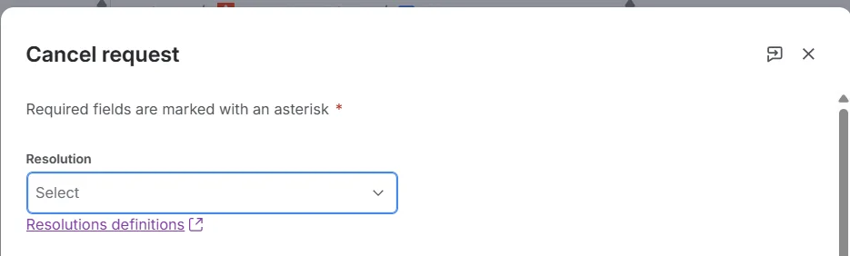</a> Reviewed the Jira cancellation form.</td><td width="50%"></td></tr>
</table>

## Jira queue prioritization exercise

I created 10 support tickets (AIT-5 through AIT-14) in Jira Service Management, bringing the queue to 14 requests. They covered Okta sign-in problems, employee onboarding and offboarding, MFA recovery, 1Password access, Mac encryption, meeting-room audio, Greenhouse SSO and routine software requests.

I reviewed the queue and prioritized tickets based on user impact, urgency, security risk and SLA deadlines. I focused first on a multi-user Okta sign-in incident, time-sensitive access removal and an upcoming company meeting. I assigned ticket owners and updated statuses as I worked through the queue.

For AIT-5, I changed the status to Work in progress, recorded an internal triage note and sent a customer update requesting error details. I also checked the SLA targets and time-to-resolution information in Jira.

### Jira queue and triage evidence

<table>
<tr>
<td width="50%" valign="top"><a href="evidence/AIT-QUEUE-01-all-open-14-tickets.webp">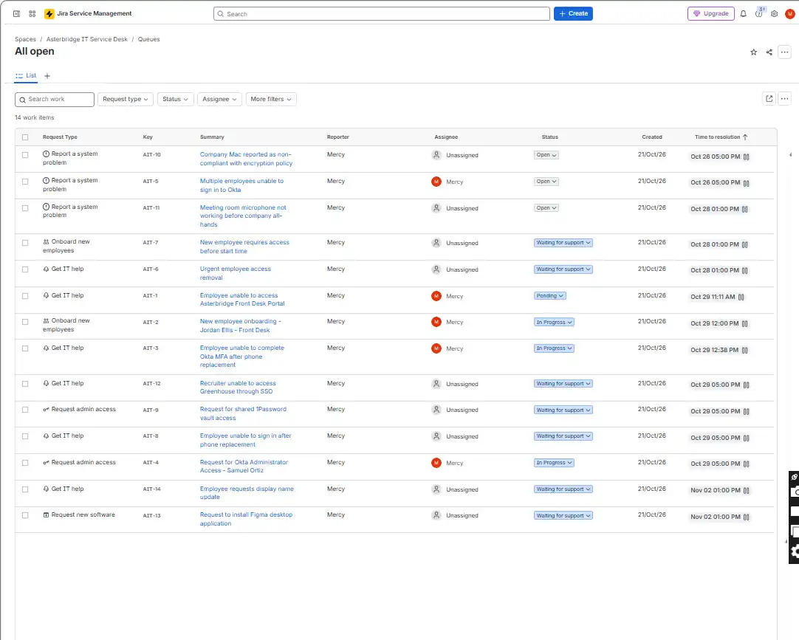</a> All 14 requests in the Jira queue.</td>
<td width="50%" valign="top"><a href="evidence/AIT-QUEUE-02-triage-ownership-status.webp">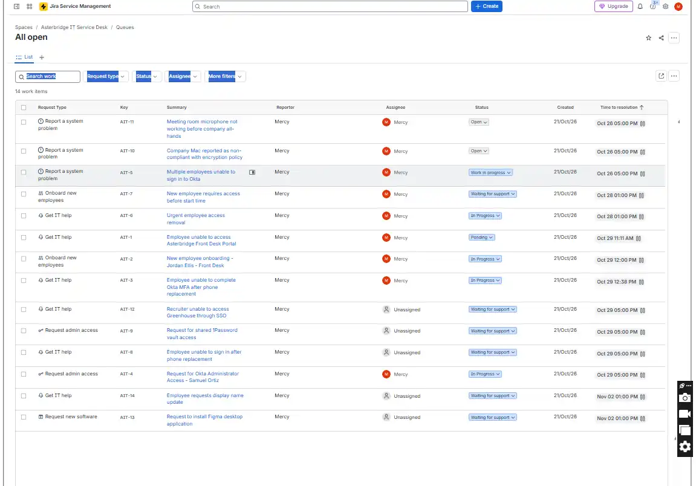</a> Ticket ownership and status updates after triage.</td>
</tr>
<tr>
<td colspan="2" valign="top"><a href="evidence/AIT-QUEUE-03-incident-notes-sla.webp">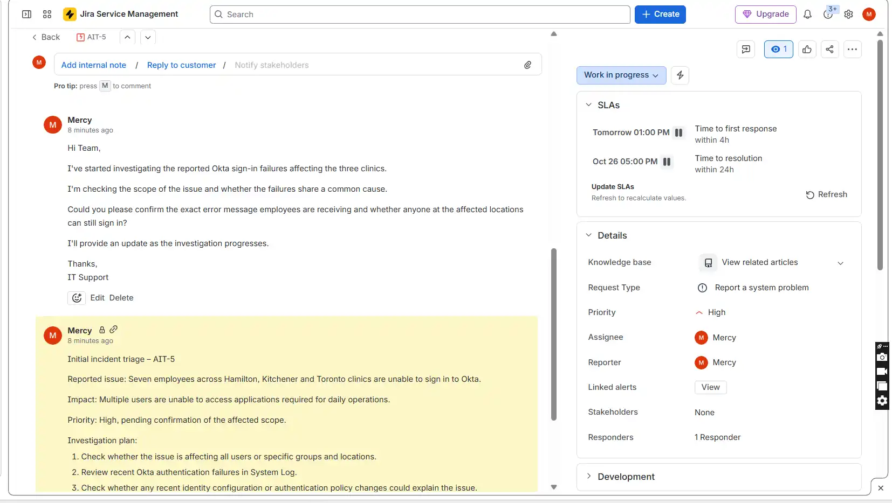</a> AIT-5 internal investigation note, customer update, priority and SLA details.</td>
</tr>
</table>

## Documentation

- [Test results](docs/test-cases.md)
- [Support runbooks](docs/runbooks.md)
- [Evidence file index](evidence/README.md)
