# Project 07: Okta–Salesforce SAML SSO & Access Troubleshooting

## Overview

I connected Okta to a real Salesforce Developer Edition organization using SAML 2.0, then tested how employees receive application access and what happens when something breaks.

I built this around the support requests I could face as an onsite IT Support Specialist: a new Sales employee needs access, an existing employee loses an app, a user can sign in to Okta but Salesforce rejects them, several employees are affected by the same SSO issue, and a user can sign in but cannot perform an approved action.

I used two fictional employees, Jordan Ellis and Hannah Reid, in my Asterbridge Care Technologies lab. I configured the systems, introduced controlled faults, investigated the resulting errors, corrected them and retested.

## Environment

- Okta Admin Console and two existing Okta employee accounts
- Salesforce Developer Edition (Sales application)
- SAML 2.0, signed assertions and Okta signing certificate
- Okta group: `APP-Salesforce-Sales`
- Salesforce Standard User profiles and the `Asterbridge Campaign Creator` permission set
- Salesforce Login History and SAML Assertion Validator
- Existing AD-backed Okta authentication for the two lab users

The important distinction in this project is that Okta authenticates users and assigns the application, while Salesforce validates the SAML assertion and controls permissions inside its CRM.

## 1. I configured Salesforce as a real SAML application in Okta

1. I created a Salesforce Developer Edition organization and located its Organization ID in Salesforce **Setup → Company Information**.
2. In Okta's App Catalog, I added the **Salesforce.com** integration and named it `Salesforce.com – Asterbridge`.
3. I selected the Salesforce **Production** instance type for the Developer Edition login environment, entered my real Organization ID and chose **SAML 2.0** instead of Secure Web Authentication.
4. I kept the Default Relay State and Logout URL blank and left Single Logout disabled for the initial test.
5. Okta generated the SAML metadata, sign-on URL, issuer and signing certificate. I used its active SHA-2 certificate.
6. In Salesforce, I opened **Setup → Single Sign-On Settings** and enabled organization-wide SAML.
7. I imported Okta's identity provider metadata into Salesforce and reviewed the issuer, certificate, Entity ID, NameID location and HTTP POST binding.
8. I saved the setting as `Okta Asterbridge SSO`. Salesforce's Entity ID used my actual Developer Edition My Domain, not a placeholder.
9. I copied the Salesforce-generated Login URL into the Okta application's Sign On settings and configured the matching custom domain.

### What went wrong: Salesforce initially refused to import Okta's metadata

When I first used **New from Metadata URL**, Salesforce returned:

> Specify a public URL from Remote Site Settings.

I checked the message rather than manually guessing the issuer or certificate. In Salesforce **Remote Site Settings**, I created an active entry for my Okta domain, then retried the same metadata URL.

The import worked. Salesforce populated its SAML identity provider settings, including the certificate and login URL, which I then reviewed before saving.

This was my first configuration lesson: a metadata import error can be caused by the service provider's outbound URL restrictions, even when the Okta metadata itself is valid.

## 2. I created the employee accounts and assigned access through an Okta group

1. I checked Salesforce's available user licenses before creating employees. The organization had enough standard Salesforce licenses for Jordan and Hannah.
2. I created **Jordan Ellis** with a Standard User profile and the Salesforce username `jordan.ellis@asterbridge.ca`.
3. Later, I created **Hannah Reid** with the same license and profile type and the Salesforce username `hannah.reid@asterbridge.ca`.
4. I created the Okta-managed group `APP-Salesforce-Sales` for approved Sales employees.
5. I added Jordan and Hannah to the group and assigned the Salesforce application to that group. Both employee records appeared in Okta's application Assignments list with the assignment type **Group**.
6. Their Okta sign-in usernames were different from their Salesforce usernames. I edited each user's Salesforce application assignment so Okta would send the correct Salesforce username in the SAML identity:

   | Employee | Okta login | Salesforce application username |
   | --- | --- | --- |
   | Jordan Ellis | `jellis@mydomain.com` | `jordan.ellis@asterbridge.ca` |
   | Hannah Reid | `hreid@mydomain.com` | `hannah.reid@asterbridge.ca` |

I kept the **Assignment master** set to **Group**. That preserved group-based entitlement management while allowing each employee to have an application-specific username.

## 3. I troubleshot Jordan's Okta login before testing Salesforce

My first attempt to sign in as Jordan didn't reach Salesforce at all.

- Okta initially displayed **Bad request** during password verification.
- I realized my lab domain controller was powered off. Jordan was sourced from Active Directory and used delegated authentication, so I started the domain controller.
- On another attempt, Okta displayed: **Password change is currently restricted by organization policy**.
- I checked Jordan's account in Active Directory Users and Computers and found **User must change password at next logon** selected.
- I addressed that password-change requirement in the lab and retried Jordan's Okta sign-in.

Jordan successfully reached his Okta dashboard, and the Salesforce tile appeared alongside his existing Front Desk Portal tile.

This helped me separate a problem authenticating *to Okta* from a problem authenticating *from Okta to a SaaS application*. I didn't start changing Salesforce SAML settings to fix an earlier password-stage failure.

## 4. I resolved the first Salesforce SSO configuration error

When I clicked Jordan's Salesforce tile for the first time, Salesforce displayed a generic **Single Sign-On Error**.

I checked **Salesforce Setup → Login History** rather than relying on the generic browser message. The attempt was listed as:

- Login type: **SAML IdP Initiated SSO**
- Username: `jordan.ellis@asterbridge.ca`
- Status: **Failed: Configuration Error/Perm Disabled**

I returned to **Single Sign-On Settings**, checked the organization-level **SAML Enabled** option, enabled it, saved the setting and retested.

Jordan then reached the Salesforce **Seller Home** page without entering a separate Salesforce password. Login History showed a new **Success** entry for **SAML IdP Initiated SSO**.

That was my first verified end-to-end Okta-to-Salesforce login, using a standard employee account rather than my administrator session.

## 5. Scenario 1 — New Sales employee needs Salesforce access

**Request:** A new Sales employee can access Okta but needs approved CRM access.

**What I did**

1. Created Jordan's Salesforce account with the Standard User profile.
2. Created an Okta group specifically for Sales application access.
3. Assigned the Salesforce integration to the group and added Jordan.
4. Set Jordan's application-specific username to match the Salesforce user.
5. Signed into Okta as Jordan, opened the Salesforce tile and confirmed his Salesforce homepage.
6. Verified a successful SAML IdP Initiated SSO event in Salesforce Login History.

**Result:** The employee received the application through an approved group and successfully authenticated to the CRM.

## 6. Scenario 2 — Salesforce disappears from an employee's Okta dashboard

**Request:** Jordan used Salesforce earlier, but now the tile is missing from Okta.

**How I reproduced it**

1. I removed Jordan from `APP-Salesforce-Sales`.
2. I refreshed his Okta dashboard.
3. The Salesforce tile disappeared, while his other assigned application remained visible.

**How I investigated and fixed it**

1. I checked the Salesforce application's Assignments list in Okta and traced the entitlement to the group.
2. I restored Jordan's group membership, representing reapproval of access for this controlled test.
3. I verified he appeared again as a **Group** assignment.
4. I checked his application-specific username because removing and restoring an assignment can affect per-user application values.
5. I refreshed his dashboard, confirmed the Salesforce tile returned, clicked it and verified Salesforce opened as Jordan.

**Result:** I reproduced and restored a missing application entitlement without resetting the employee's password or MFA.

## 7. Scenario 3 — Okta works, but Salesforce cannot identify the employee

**Request:** Jordan can sign into Okta and see Salesforce, but the application rejects the SSO login.

**How I reproduced it**

I deliberately changed only Jordan's Okta application-specific Salesforce username from `jordan.ellis@asterbridge.ca` to `jellis@mydomain.com`. I left his primary Okta account, group membership and Salesforce account unchanged.

Salesforce displayed **Single Sign-On Error**.

**How I investigated it**

1. I checked Salesforce Login History. The newest failed attempt did not appear alongside the earlier entries, so Login History wasn't enough to explain this failure.
2. I opened **Salesforce → Single Sign-On Settings → SAML Assertion Validator**.
3. The validator showed the incoming Subject as `jellis@mydomain.com` and reported:

   > Unable to map the subject to a Salesforce user

4. I compared that subject with the actual Salesforce username `jordan.ellis@asterbridge.ca`. They did not match.

**How I fixed it**

I restored the correct application-specific username in Okta while keeping Jordan's assignment group-managed, then performed a fresh SSO test.

**Result:** Salesforce recognized Jordan again and SSO succeeded. The validator gave me the specific cause that the browser error and Login History did not.

## 8. Scenario 4 — A shared SAML setting breaks access for multiple employees

**Request:** Sales employees in different locations can authenticate to Okta, but Salesforce sign-in stops working.

**How I reproduced it**

1. I first verified that **both Jordan and Hannah** could independently sign into Salesforce through Okta.
2. In the Salesforce `Okta Asterbridge SSO` configuration, I recorded the correct issuer.
3. I changed only the shared Salesforce **Issuer** to `invalid-issuer-asterbridge-test`.
4. I retried SSO and reproduced the Salesforce error while keeping the employee accounts and group assignments intact.

**How I investigated it**

The Salesforce SAML Assertion Validator gave a specific mismatch:

> Response's issuer did not match the issuer configured in the Single Sign-On Setting.

It displayed the issuer sent by Okta (`exk193ouiw90XAwFP698`) and the incorrect issuer configured in Salesforce (`invalid-issuer-asterbridge-test`).

**How I fixed it**

I copied the original issuer from **Okta → Salesforce.com – Asterbridge → Sign On → More details**, restored it in Salesforce and saved the setting.

I then signed in as both Jordan and Hannah again. Each reached their respective Salesforce **Seller Home** page.

**Result:** I tested a shared integration configuration fault, used a precise SAML validation error to find the cause and verified recovery for two employees. This is different from the individual group-assignment and username problems.

## 9. Scenario 5 — SSO succeeds, but the employee cannot create a campaign

**Request:** Hannah can enter Salesforce, but a manager has approved her to create campaigns and the **New** button is missing.

**What I checked**

1. I signed into Salesforce as Hannah and opened **Campaigns**. The page opened, but it showed no **New** button.
2. I found the **Marketing User** checkbox on Hannah's Salesforce account was not enabled.
3. I enabled it and retested. The **New** button still did not appear.
4. I inspected her **Standard User** profile's Campaign object permissions. **Read** was allowed, but **Create** and **Edit** were not.
5. I couldn't change those permissions on the standard profile, so I created a targeted permission set instead of broadening access for everyone.

**What I changed**

I created `Asterbridge Campaign Creator` with the following Campaign permissions:

| Permission | Setting |
| --- | --- |
| Read | Enabled |
| Create | Enabled |
| Edit | Enabled |
| Delete | Not granted |
| View All / Modify All Records | Not granted |

I assigned it only to Hannah and set the assignment to expire on **October 31, 2026** (seven days after the test).

**How I verified it**

After refreshing Hannah's Campaigns page, the **New** button appeared. I clicked it and successfully created the fictional record **Asterbridge Q4 Sales Outreach – LAB**, with the campaign status **Planned**.

**Result:** Hannah could complete the approved action. I verified the permission change by performing the task, not just by seeing a successful assignment message.

## Test results

| Test | Result | Verification |
| --- | --- | --- |
| Okta ↔ Salesforce SAML integration | Passed | Jordan and Hannah reached Salesforce through the Okta tile |
| Group-based Salesforce entitlement | Passed | Both appeared as group-assigned in Okta |
| Application username mapping | Passed | Correct Salesforce NameID allowed successful sign-in |
| Initial SAML configuration recovery | Passed | Login History changed from configuration failure to success |
| Missing assignment and restoration | Passed | Tile disappeared and returned; login succeeded |
| Invalid NameID and restoration | Passed | SAML Validator showed unmapped Subject; correct mapping restored login |
| Shared issuer mismatch and restoration | Passed | SAML Validator identified issuer mismatch; both users recovered |
| Salesforce object permission change | Passed | Hannah's New Campaign button appeared and a campaign was created |

## Evidence gallery

### SAML integration and employee setup

<table>
<tr>
<td width="50%" valign="top"><a href="evidence/18-metadata-import-remote-site-error.webp">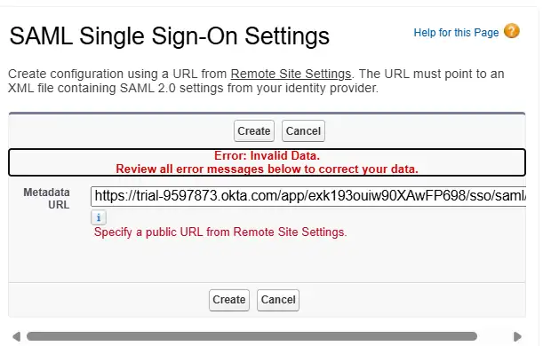</a> Salesforce rejected the metadata URL because the Okta domain needed an active Remote Site Settings entry.</td>
<td width="50%" valign="top"><a href="evidence/01-saml-setup.webp">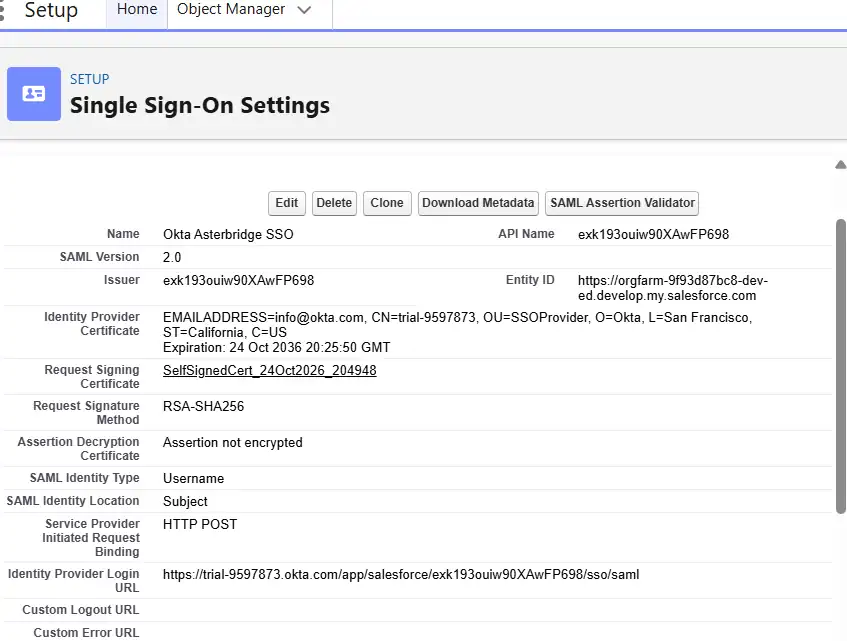</a> Saved Salesforce SAML configuration with the imported identity provider settings.</td>
</tr>
<tr>
<td width="50%" valign="top"><a href="evidence/02-okta-salesforce-app.webp">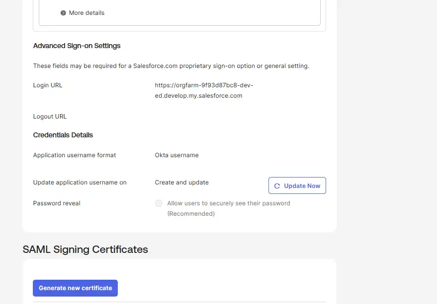</a> Configured the Salesforce application's Sign On settings and certificate in Okta.</td>
<td width="50%" valign="top"><a href="evidence/03-salesforce-user-jordan.webp">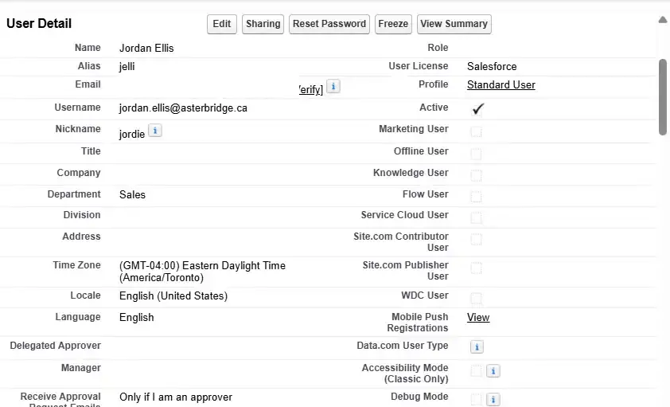</a> Created Jordan as an active Salesforce Standard User.</td>
</tr>
<tr>
<td width="50%" valign="top"><a href="evidence/04-okta-group-assignment.webp">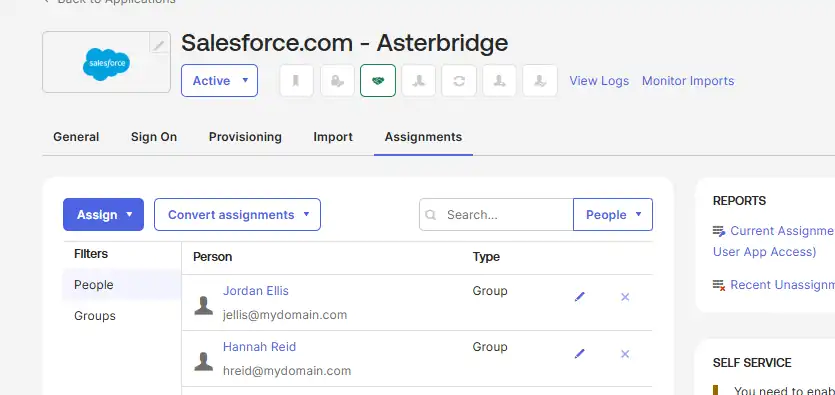</a> Both employees assigned through the Okta group rather than directly.</td>
<td width="50%" valign="top"><a href="evidence/05-username-override.webp">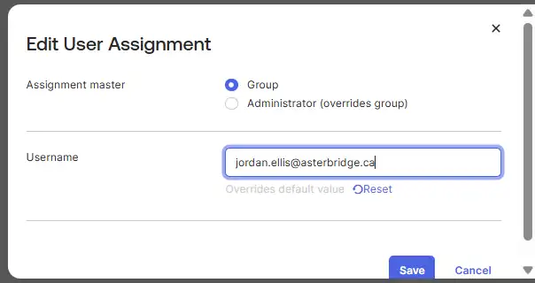</a> Mapped Jordan's Okta application username to his actual Salesforce username.</td>
</tr>
</table>

### Initial sign-in troubleshooting

<table>
<tr>
<td width="50%" valign="top"><a href="evidence/06-okta-password-policy-error.webp">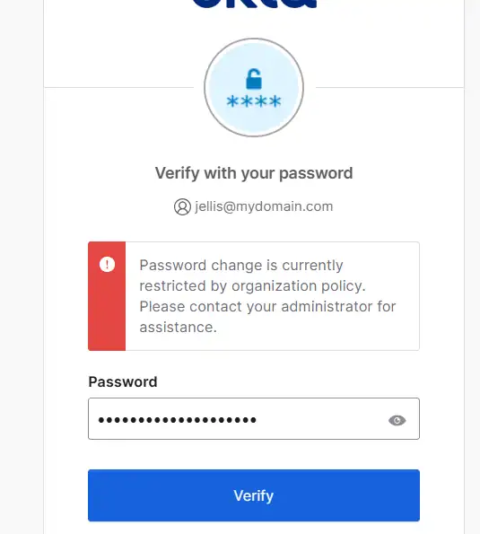</a> Okta reported a password-change restriction for the AD-sourced employee.</td>
<td width="50%" valign="top"><a href="evidence/07-salesforce-sso-disabled.webp">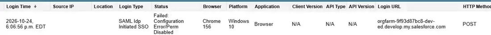</a> Salesforce Login History showed Configuration Error/Perm Disabled on the first SAML attempt.</td>
</tr>
<tr>
<td width="50%" valign="top"><a href="evidence/08-salesforce-sso-success.webp">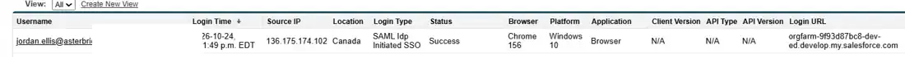</a> A later Salesforce Login History entry showed successful SAML IdP Initiated SSO.</td>
<td width="50%"></td>
</tr>
</table>

### Lost application assignment and SAML identity mismatch

<table>
<tr>
<td width="50%" valign="top"><a href="evidence/09-salesforce-tile-removed.webp">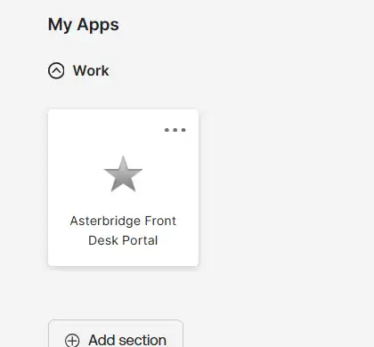</a> Removing Jordan from the access group removed the Salesforce tile.</td>
<td width="50%" valign="top"><a href="evidence/10-saml-subject-mismatch.webp">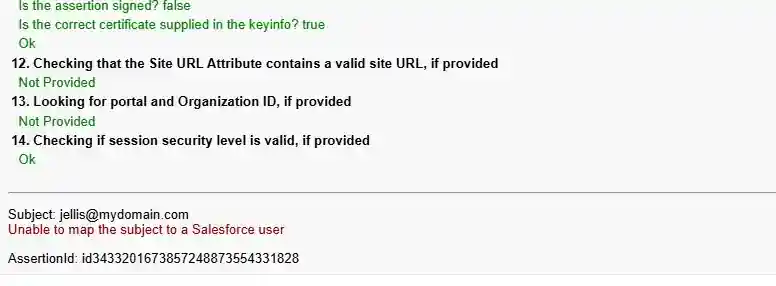</a> SAML Validator showed an unmapped Subject when Okta sent jellis@mydomain.com.</td>
</tr>
</table>

### Shared SSO outage and recovery

<table>
<tr>
<td width="50%" valign="top"><a href="evidence/11-issuer-config-break.webp">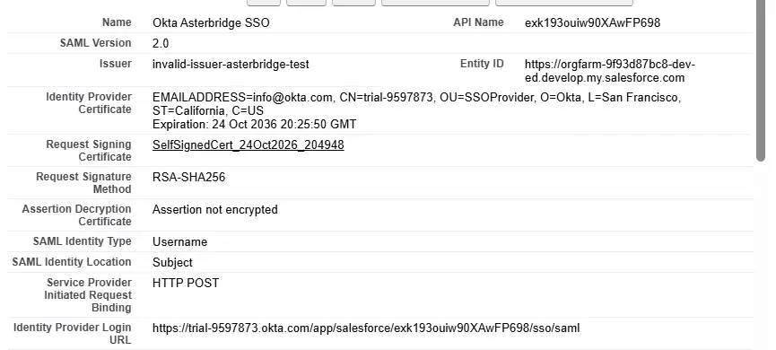</a> Deliberately set an incorrect issuer in the shared Salesforce SAML configuration.</td>
<td width="50%" valign="top"><a href="evidence/12-saml-issuer-mismatch.webp">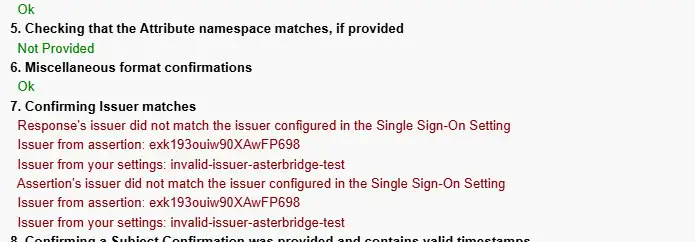</a> Salesforce Validator identified the issuer mismatch between Okta and Salesforce.</td>
</tr>
<tr>
<td width="50%" valign="top"><a href="evidence/19-both-users-recovered.webp">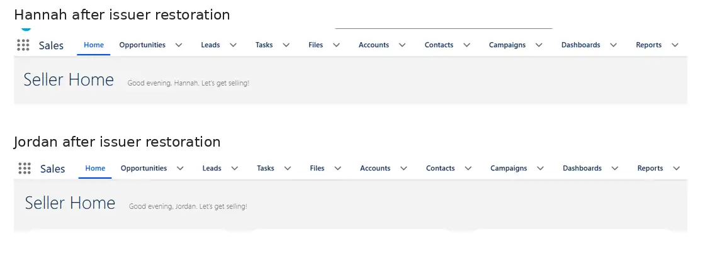</a> Two separate sessions after restoring the issuer: Hannah and Jordan both reached Salesforce.</td>
<td width="50%"></td>
</tr>
</table>

### Salesforce permissions and final verification

<table>
<tr>
<td width="50%" valign="top"><a href="evidence/13-salesforce-profile-read-only.webp">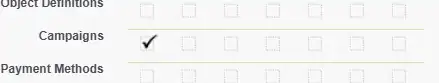</a> Hannah's Standard User profile allowed Campaign Read, but not Create or Edit.</td>
<td width="50%" valign="top"><a href="evidence/14-permission-set-scoped.webp">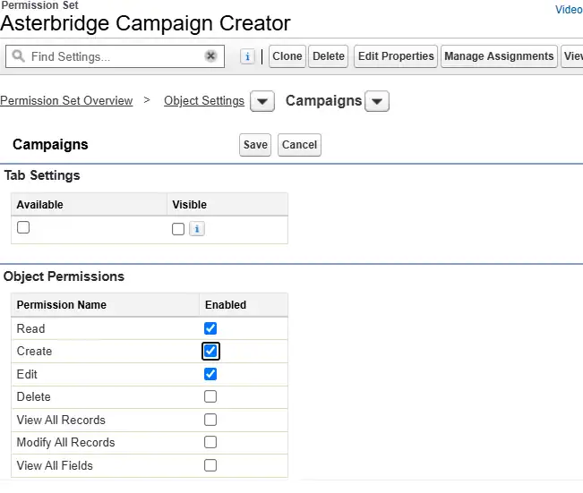</a> The Campaign Creator permission set granted Read, Create and Edit without Delete or broad access.</td>
</tr>
<tr>
<td width="50%" valign="top"><a href="evidence/15-timebound-assignment.webp">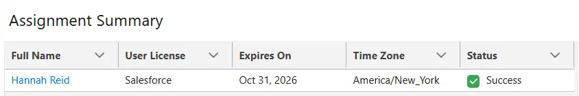</a> Assigned the permission set only to Hannah, expiring October 31, 2026.</td>
<td width="50%" valign="top"> The New button appeared after the effective permission changed.</td>
</tr>
<tr>
<td width="50%" valign="top"><a href="evidence/17-campaign-created.webp">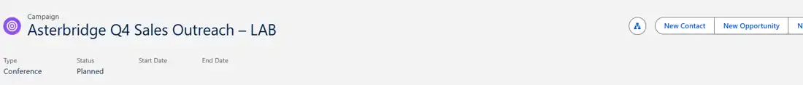</a> Hannah created Asterbridge Q4 Sales Outreach – LAB, proving the approved action worked.</td>
<td width="50%"></td>
</tr>
</table>

## Troubleshooting lessons I can explain

- I check where a sign-in fails before changing settings. Jordan's initial problem happened during Okta password verification; the later failures happened at Salesforce.
- I confirm group assignments when an application tile is missing.
- I compare the SAML Subject/NameID against the actual SaaS username when Okta sign-in works but the application rejects the employee.
- I use Salesforce Login History for failed SSO attempts and the SAML Assertion Validator when a generic error or incomplete log doesn't tell me enough.
- I investigate shared SSO configuration when several employees report the same issue.
- I distinguish successful SSO from downstream application permissions. Hannah could open Salesforce, but she still needed a specifically scoped permission set to create campaigns.
- I retest the exact user action after a fix: sign in, open the app, or create the record.

## Evidence and reference notes

This lab used fictional employee identities and a Salesforce Developer Edition organization. See [the test and troubleshooting record](docs/test-results.md) for the chronological failure, investigation and recovery checkpoints.
