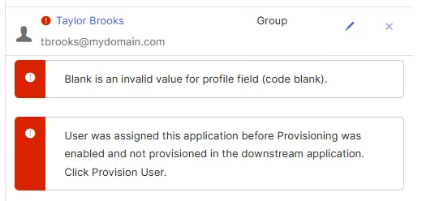
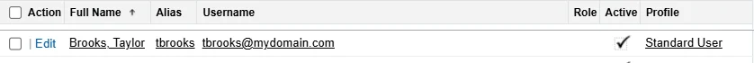
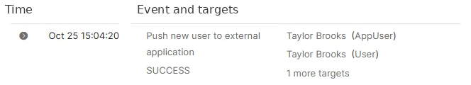
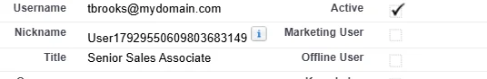
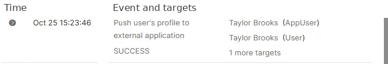
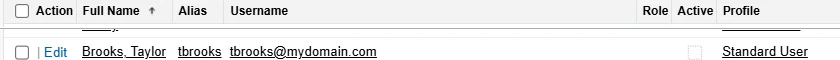
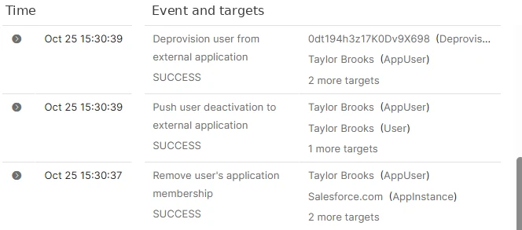

# Project 08: Okta–Salesforce Automated Provisioning

I used Okta API provisioning to create, update and deactivate a Salesforce employee account. I verified each change in Salesforce and checked the Okta System Log for the corresponding provisioning events.

Tools: Okta Integrator Free Plan, Salesforce Developer Edition, Salesforce External Client App, OAuth 2.0, Okta Profile Editor and System Log.

## Setup — Connect the provisioning API

1. My original Okta trial expired while I was configuring provisioning. I created a new Okta Integrator Free Plan organization, recreated the `APP-Salesforce-Sales` group and the Jordan Ellis/Hannah Reid Okta accounts, and reconnected SAML to the existing Salesforce organization.
2. In Salesforce, I created an External Client App called `Asterbridge Okta Provisioning`. I enabled OAuth with the `api` and `refresh_token, offline_access` scopes, used Okta's OAuth callback URL, and configured the required PKCE and refresh-token security settings.
3. In Okta → Salesforce.com – Asterbridge → Provisioning → Integration, I authenticated with Salesforce using the OAuth consumer credentials. The `To App` settings then exposed Create Users, Update User Attributes and Deactivate Users.
4. The Salesforce Developer Edition had no free standard-user licenses. I deactivated Jordan's Salesforce test account and confirmed one license was available. I kept his Okta account and lab records.

## Scenario 1 — Provision a new Sales employee

1. I enabled `Create Users` in Okta → Salesforce application → Provisioning → To App.
2. I created Taylor Brooks in Okta using the username `tbrooks@mydomain.com`, without manually creating a Salesforce account.
3. I added Taylor to `APP-Salesforce-Sales` to assign the Salesforce application.
4. The initial push failed. Okta showed `Blank is an invalid value for profile field (code blank)` and a message saying the account was assigned but not provisioned in Salesforce.

   

5. I checked the provisioning assignment and Salesforce profile requirement, then used `Retry Selected` in Okta's failed provisioning tasks. The retry succeeded. The screenshot confirms the end result; I did not capture a verified before-and-after change to a particular profile setting.
6. I checked Salesforce → Setup → Users. Taylor had been created automatically as an active `Standard User`.

   

7. I checked Okta System Log. At 3:04:20 PM on October 25, `Push new user to external application` showed `SUCCESS` for Taylor.

   

## Scenario 2 — Update a Salesforce profile from Okta

1. I enabled `Update User Attributes` in the Salesforce application's `To App` provisioning settings.
2. In Profile Editor, I checked the Salesforce `Title` attribute and mapped it from Okta `user.title` for updates.
3. I edited Taylor's Okta profile and changed the job title to `Senior Sales Associate`.
4. Salesforce → Setup → Users → Taylor Brooks displayed `Senior Sales Associate` in Title. I hadn't edited the field in Salesforce.

   

5. Okta System Log showed `Push user's profile to external application — SUCCESS` at 3:23:46 PM.

   

## Scenario 3 — Deactivate Salesforce access after offboarding

1. I enabled `Deactivate Users` in Okta's Salesforce `To App` settings. I kept password synchronization disabled because the lab uses SAML SSO.
2. I removed Taylor from `APP-Salesforce-Sales`, which removed the Salesforce application assignment.
3. In Salesforce → Setup → Users, Taylor's account still existed but `Active` was unchecked. I did not manually deactivate Taylor in Salesforce.

   

4. The Okta System Log showed `Remove user's application membership`, `Push user deactivation to external application` and `Deprovision user from external application`, each with `SUCCESS` at approximately 3:30 PM.

   

## Results

| Test | Salesforce result | Okta evidence |
| --- | --- | --- |
| Create employee | Taylor appeared as an active Standard User | Successful `Push new user to external application` |
| Update job title | Salesforce showed `Senior Sales Associate` | Successful `Push user's profile to external application` |
| Remove Sales access | Taylor's Salesforce account became inactive | Successful deactivation and deprovisioning events |

The tests used fictional employees in my existing Asterbridge Salesforce lab. I kept the Salesforce user records so I could verify creation, update and deactivation without deleting audit history.
